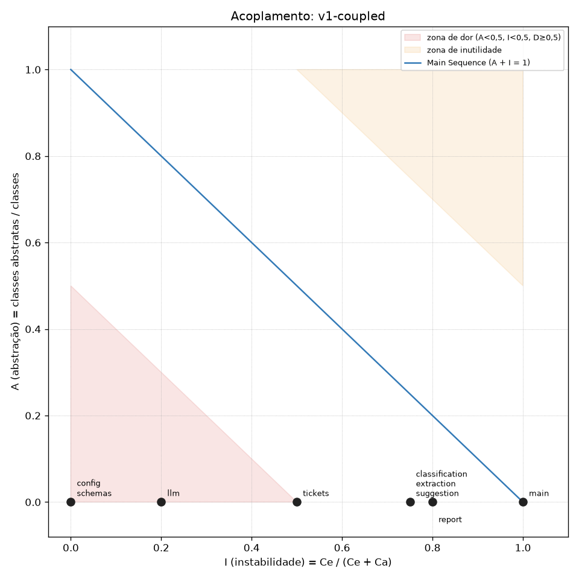
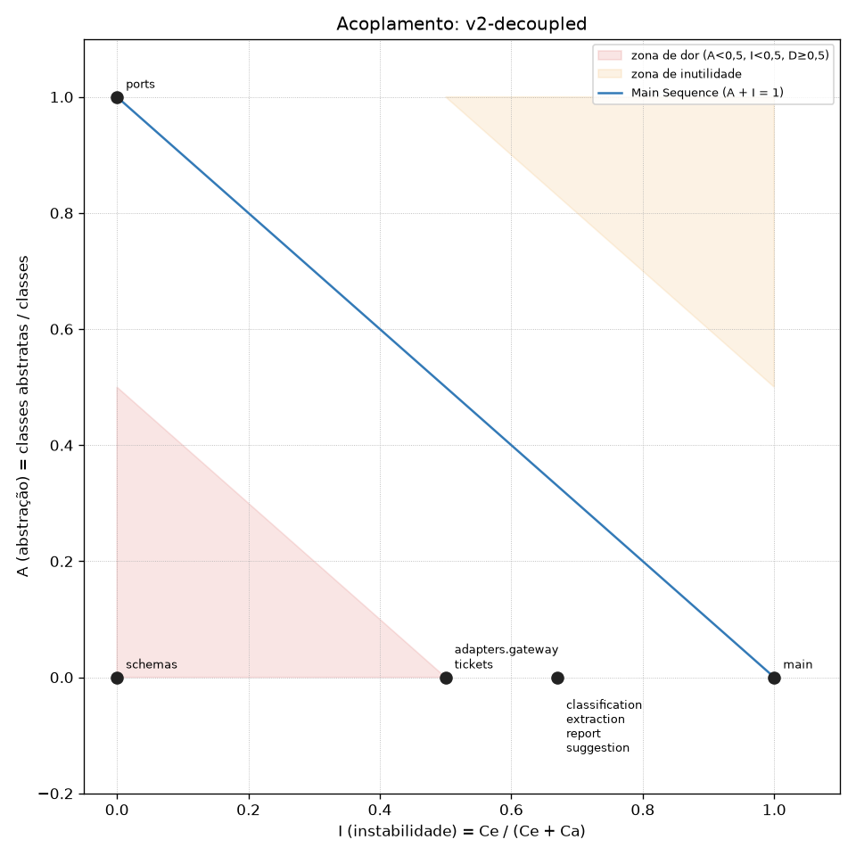
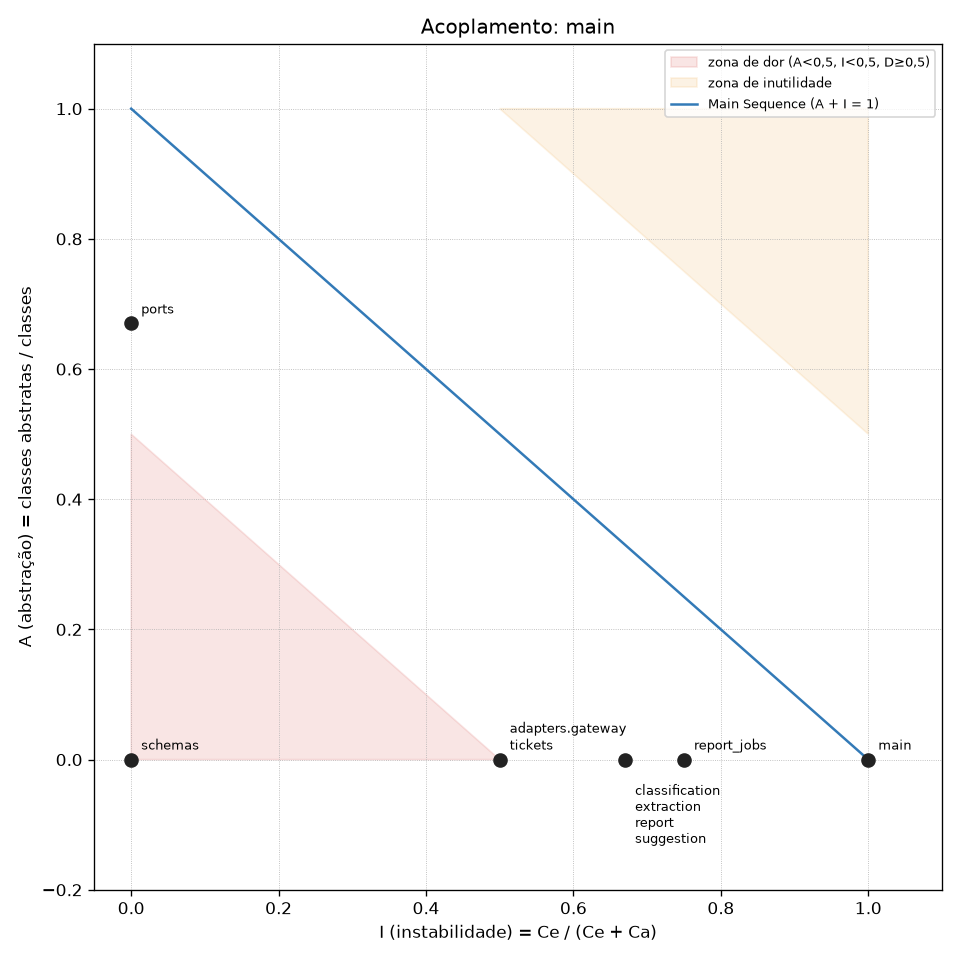

# Helpdesk com IA: da integração frágil à arquitetura resiliente

Entrega do desafio [Da integração frágil à arquitetura resiliente](https://github.com/devfullcycle/desafio-arquitetura-era-ia-1) (o enunciado completo continua no `README.md` do repositório base). O plano de execução e a rastreabilidade dos critérios estão em [`docs/implementation-master-plan.md`](docs/implementation-master-plan.md) e [`docs/acceptance-matrix.md`](docs/acceptance-matrix.md).

> **Versões:** tag [`v1-coupled`](../../tree/v1-coupled) (original, com a suíte de caracterização), tag [`v2-decoupled`](../../tree/v2-decoupled) (mesmo comportamento, atrás do AI Gateway) e branch `main` (F1/F4 síncronos, F2 em streaming SSE, F3 assíncrono, com governança e resiliência no gateway). O diagnóstico abaixo descreve a v1.

## Visão geral

A aplicação (FastAPI, `app/helpdesk/`) não conhece provider, modelo físico nem chave de provider: cada feature pede uma **capacidade lógica** (`helpdesk-classify`, `helpdesk-suggest`, `helpdesk-topics`, `helpdesk-extract`) por uma porta (`ports.LLMGateway`), e o único componente que fala com o modelo, `adapters/gateway.py` (`GatewayClient`, SDK `openai`), chama o **AI Gateway** (serviço `gateway`, LiteLLM Proxy, [ADR 0001](docs/adr/0001-adotar-litellm-proxy-como-ai-gateway.md)) com uma chave virtual própria. O gateway mapeia cada capacidade para um modelo físico ([ADR 0002](docs/adr/0002-expor-capacidades-logicas-por-feature.md)) e guarda as chaves virtuais e o gasto no `gateway-db` ([ADR 0003](docs/adr/0003-persistir-chaves-e-gasto-no-postgres-do-gateway.md)). **Quando um provider cai**, cada capacidade passa para o modelo `large` equivalente do outro provider (mesma saída), depois de no máximo 2 tentativas no primário; sem nenhum `large`, F1/F2/F3 respondem com um modelo `mini` e a F4 (extração para uma automação sem revisão humana) falha explicitamente com `503` ([ADR 0006](docs/adr/0006-fallback-tecnico-e-politica-de-modelo-fraco-por-feature.md)). Timeout, retry e fallback moram no gateway; o app não faz retry ([ADR 0009](docs/adr/0009-concentrar-timeout-e-retry-no-gateway.md)). O gasto tem teto mensal e cada chave pode ter orçamento e limite de requisições, recusados antes do provider ([ADR 0004](docs/adr/0004-governar-acesso-com-chaves-orcamento-e-limite.md), [ADR 0005](docs/adr/0005-limitar-gasto-mensal-e-providers-aceitos.md)).

```text
cliente ──► edge (nginx, :8000, corta em 30 s) ──► app (FastAPI)
                                                     │  features ──► ports.LLMGateway (porta)
                                                     │  main ──► adapters/gateway.py (único cliente do modelo)
                                                     ▼
                                     gateway (LiteLLM, :4000) ──► provider-fake (openai/*, anthropic/*)
                                                     │
                                                     ▼
                                           gateway-db (Postgres: chaves virtuais e gasto)
```

- **Serviços além dos do repositório base:** `gateway` ([ADR 0001](docs/adr/0001-adotar-litellm-proxy-como-ai-gateway.md)) e `gateway-db` ([ADR 0003](docs/adr/0003-persistir-chaves-e-gasto-no-postgres-do-gateway.md)). As chaves virtuais são semeadas pelo próprio entrypoint do gateway (sem serviço `gateway-init`). `provider-fake/`, `edge/` e `data/` não foram alterados.
- **Máximo de tentativas por destino:** 2 para falhas transitórias (500/503/429) e 1 para timeout; o app não faz retry ([Tabela de capacidades](#tabela-de-capacidades)).
- **Contratos que mudaram na `main`** (os campos de F1 e F4 e o conteúdo de F2 e F3 continuam os da v1; ver [Fluxos](#fluxos)):
  - F2 responde `text/event-stream`: eventos `data: {"chunk": "..."}`, `event: end` com `{"ticket_id"}` e, se a geração falhar no meio, `event: error` com `{"ticket_id", "message"}`.
  - F3 responde `202` com `{"job_id", "state"}`, `Location` e `Retry-After`; a URL de status devolve `{"state", "progress"?, "reason"?}` (`pending | running | failed`) ou `303` para o resultado, que tem os mesmos campos do relatório da v1.
  - Sem destino disponível, F1–F4 respondem `503 {"detail": "Capacidade <nome> indisponível: <motivo>"}`, sem `504` da borda.

## Diagnóstico da v1

Ambiente: `cp .env.example .env && docker compose up -d --build --wait`, provider simulado em modo normal salvo indicação, todas as requisições **pela borda** (`localhost:8000`). Os comandos estão versionados em [`scripts/diagnostics/`](scripts/diagnostics/), e as saídas brutas em [`docs/evidence/f01/`](docs/evidence/f01/). Medido em 2026-10-13 (Docker Desktop 29.7.2, Windows 11).

> **Nota sobre Windows:** acentos passados como argumento do `curl` no Git Bash/PowerShell chegam corrompidos e a aplicação responde `400 {"detail":"There was an error parsing the body"}`. Por isso, todos os comandos enviam o corpo de arquivo: `--data-binary @scripts/diagnostics/payloads/<arquivo>.json`.

### Linha de base (modo normal)

`bash scripts/diagnostics/features.sh` ([evidência](docs/evidence/f01/features/))

| Feature | Rota | Status | Tempo total pela borda | Chamadas ao provider |
|---|---|---|---|---|
| F1 Classificar | `POST /tickets/classification` | 200 `{"ticket_id":"TK-00042","category":"delivery","priority":"high"}` | 1,08 s | 1 × `openai/gpt-fake-large` |
| F2 Sugerir | `POST /tickets/reply-suggestion` | 200, 2.606 bytes, `application/json` | **15,96 s** (1º byte também em 15,96 s) | 1 × `anthropic/claude-fake-large`, 606 tokens de saída |
| F3 Relatório (1 dia) | `POST /reports/topics` `2026-08-01`→`2026-08-01` | 200, `total_tickets: 137` | 9,85 s | 1 × `anthropic/claude-fake-large` (6.132 tokens in) |
| F4 Extrair | `POST /tickets/extraction` | 200 `{"order_number":"#481516","product":null}` | 1,08 s | 1 × `openai/gpt-fake-large` |

### Dor 1: o relatório do mês não chega

**Comando:** `bash scripts/diagnostics/pain1_report.sh`, que faz `POST /reports/topics` com `{"start":"2026-08-01","end":"2026-08-31"}` e depois acompanha `GET localhost:8090/admin/calls` a cada 15 s.

**Observado** ([relatório](docs/evidence/f01/pain1-report.txt), [linha do tempo](docs/evidence/f01/pain1-calls-after-504.txt), [resumo](docs/evidence/f01/pain1-summary.txt), [registro bruto](docs/evidence/f01/pain1-admin-calls.json)):

- A borda responde **`504 Gateway Time-out` em 30,03 s** (página HTML do nginx). O cliente não recebe nada do relatório.
- No momento do 504, o provider tinha recebido **4** das chamadas `topics`. A aplicação **continuou**: o `/admin/calls` foi de 4 para **34 chamadas** (5.000 tickets / 150 por lote), todas `claude-fake-large`, status 200, ~9,7 s cada, uma depois da outra. A última terminou às 15:09:26, **331 s** depois da primeira e ~5 min depois de a borda desistir.
- Custo, pelos preços do `provider-fake/README.md`: 222.114 tokens de entrada + 12.162 de saída = **US$ 0,85** por relatório. **30 chamadas (US$ 0,75, 88%) começaram depois do 504**, pagas sem ninguém para receber o resultado ("desistir não é cancelar").

**Causa:**

- `app/helpdesk/main.py:30-32`: a rota `POST /reports/topics` é síncrona e só devolve o relatório inteiro no fim.
- `app/helpdesk/report.py:15-18`: o loop processa os lotes **sequencialmente**, 34 × ~9,7 s ≈ 330 s, muito acima da paciência da borda.
- `edge/nginx.conf` (`proxy_read_timeout 30s`): sem nenhum byte em 30 s, a borda corta com 504. O timeout mais curto da cadeia vence, e não é o da aplicação.
- Nada liga o fim da conexão ao trabalho em andamento: a thread do FastAPI segue chamando o provider depois que o cliente se foi.

### Dor 2: a sugestão deixa o atendente esperando sem ver nada

**Comando:** `bash scripts/diagnostics/pain2_suggestion.sh`, que faz `curl -sN -X POST localhost:8000/tickets/reply-suggestion` medindo o tempo até o primeiro byte.

**Observado** ([evidência](docs/evidence/f01/pain2-suggestion.txt)): `status=200 content_type=application/json` **ttfb = 15,96 s, total = 15,96 s**. O primeiro byte só chega quando o texto inteiro (2.606 bytes) está pronto. No `/admin/calls`: 1 chamada `claude-fake-large`, `stream: false`, 606 tokens de saída, `duration_ms: 15951`. É coerente com o README do provider: 800 ms até o primeiro token + 606 tokens a 40 tok/s ≈ 16 s.

**Causa:**

- `app/helpdesk/llm.py:20-26`: `call_anthropic` usa `messages.create` **sem streaming** e só retorna o texto completo.
- `app/helpdesk/suggestion.py:5-7` e `app/helpdesk/main.py:20-22`: a rota devolve um JSON único (`ReplySuggestion`), então não há como mostrar o texto aos poucos, embora o provider gere token a token.

### Dor 3: com um provider fora do ar ou travado, parte do helpdesk para

**Comando:** `bash scripts/diagnostics/pain3_provider_down.sh`, que usa `POST localhost:8090/admin/failures` para derrubar um provider de cada vez e chama as features pela borda.

**Observado** ([evidência](docs/evidence/f01/pain3-provider-down.txt), [padrões dos SDKs](docs/evidence/f01/sdk-defaults.txt)):

| Cenário | F1 | F4 | F2 | F3 (1 dia) | `/admin/calls` |
|---|---|---|---|---|---|
| `openai` em `error_500` | **500** em 1,19 s | **500** em 1,44 s | 200 | 200 | **3 chamadas por requisição** (1 + 2 retries do SDK, com ~0,4 s e ~0,8 s de espera), todas 500 |
| `anthropic` em `error_500` | 200 | — | **500** em 1,24 s | **500** em 1,51 s | 3 chamadas `claude-fake-large` 500 por requisição |
| `openai` em `timeout` | **504 da borda em 30,03 s** | — | — | — | 1 chamada `classify` com `duration_ms: null` (ainda aberta) |

- A aplicação devolve `500 Internal Server Error` em texto puro (exceção não tratada do SDK), sem dizer o que falhou.
- Os padrões dos SDKs instalados (`openai 3.19.0`, `anthropic 1.8.0`): **`DEFAULT_MAX_RETRIES = 2`** e **`DEFAULT_TIMEOUT = Timeout(connect=5.0, read=600, ...)`**. Uma chamada travada pode prender a requisição por até 3 × 600 s, contra os **30 s** da borda.
- **Requisição zumbi** ([evidência](docs/evidence/f01/pain3-zombie.txt)): a F1 com `openai` em `timeout` recebeu 504 da borda às 15:12:23. Logo depois, o provider voltou ao normal (`/admin/reset`, que também limpa o registro) e nenhuma requisição nova foi feita. Mesmo assim, às **15:16:53** o `/admin/calls` registrou uma nova chamada `openai/gpt-fake-large classify` (status 200). Era o **retry do SDK**: o provider segurou a primeira tentativa por 300 s, respondeu 504, e o SDK tentou de novo, ~5 min depois de o cliente ter desistido.

**Causa:**

- `app/helpdesk/config.py:9-13`: cada feature está **fixada** num provider (`CLASSIFICATION_MODEL`/`EXTRACTION_MODEL` no `gpt-fake-large`; `SUGGESTION_MODEL`/`REPORT_MODEL` no `claude-fake-large`), sem destino alternativo, embora os dois `large` sejam equivalentes.
- `app/helpdesk/llm.py:8-9`: clientes criados **sem `timeout` nem `max_retries`**, valendo os padrões acima (600 s, 2 retries).
- `app/helpdesk/llm.py:12-26`: `call_openai`/`call_anthropic` não tratam erro nem tentam outro provider; a exceção vira 500 genérico.

### Dor 4: trocar o modelo de uma feature exige mudar código e reconstruir

**Comando:** `bash scripts/diagnostics/pain4_model_swap.sh`, que troca o modelo da F1 de `gpt-fake-large` para `gpt-fake-mini` **temporariamente** e restaura no fim.

**Observado** ([evidência](docs/evidence/f01/pain4-model-swap.txt)):

| Passo | Ação | Imagem / início do container `app` | Modelo da F1 no `/admin/calls` |
|---|---|---|---|
| 0 | estado inicial | `ba55f9b0…` / 15:00:06 | `gpt-fake-large` |
| 1 | editar `app/helpdesk/config.py:10` (`CLASSIFICATION_MODEL = "gpt-fake-mini"`) | — | — |
| 2 | `docker compose restart app` | `ba55f9b0…` (mesma) / 15:17:23 | **`gpt-fake-large`**: o restart não troca o modelo |
| 3 | `docker compose up -d --build --wait app` (7 s neste host) | **`ccfa4c0c…` (nova)** / 15:17:32 | `gpt-fake-mini` |
| 4 | `git checkout -- app/` + rebuild | `1046826c…` / 15:17:39 | `gpt-fake-large`; `git diff --quiet upstream/main -- app/` OK |

Trocar o modelo de uma única feature exigiu editar código, gerar uma imagem nova e recriar o container da aplicação, ou seja, um deploy (com a indisponibilidade do app durante a recriação). A alteração foi desfeita: `app/` continua idêntico ao do repositório base.

**Causa:**

- `app/helpdesk/config.py:10-13`: os nomes **físicos** dos modelos são constantes no código.
- `app/Dockerfile` (`COPY helpdesk ./helpdesk`): o código é copiado para dentro da imagem, então mudar uma constante exige **rebuild** e recriação do container (um deploy).
- `app/helpdesk/config.py:3-4` + `compose.yaml` (`env_file: .env` no serviço `app`): as chaves dos dois providers também vivem na aplicação.

### Large × mini (insumo para a política de fallback)

**Comando:** `python scripts/diagnostics/compare_models.py`, que chama o provider direto (`localhost:8090`) nas quatro tarefas, com os quatro modelos, numa amostra fixa de `data/tickets.jsonl` ([resumo](docs/evidence/f01/models-compare/summary.md), CSVs na mesma pasta).

| Tarefa | Amostra | Mini vs. large | Tempo (large → mini) |
|---|---|---|---|
| `classify` | 40 tickets | **idêntico** em 40/40 | 1,1 s → 0,4 s |
| `extract` | 40 tickets | **diverge em 9/40**: em 4, devolve o número da **nota fiscal** como `order_number` (ex.: TK-00002 "nota fiscal 530720 … pedido #605065" → mini `#530720`), em formato válido, que passa por `extraction.py:16`; em 6, perde o `product` | 1,1 s → 0,4 s |
| `suggest` | 5 tickets | texto válido, mas com ~44% do tamanho (≈1.070 vs. ≈2.430 caracteres) | 16 s → 2,1 s |
| `topics` | 1 lote de 150 | **idêntico** (mesmos temas, counts e exemplos) | 9,8 s → 2,7 s |

Os dois `large` deram saídas idênticas entre si nas quatro tarefas.

## Como rodar

```bash
cp .env.example .env
docker compose up -d --build --wait
curl -s localhost:8000/health
```

Serviços: `edge` (borda, `localhost:8000`), `app` (helpdesk), `gateway` (LiteLLM, `localhost:4000`), `gateway-db` (Postgres do gateway) e `provider-fake` (`localhost:8090`). A chave virtual do app é criada na subida, sem passo manual; o `--wait` só retorna quando ela já existe.

Diagnóstico da v1 (exige o compose no ar; Git Bash ou bash):

```bash
bash scripts/diagnostics/features.sh            # F1–F4 em modo normal
bash scripts/diagnostics/pain1_report.sh        # dor 1 (~6 min)
bash scripts/diagnostics/pain2_suggestion.sh    # dor 2
bash scripts/diagnostics/pain3_provider_down.sh # dor 3
bash scripts/diagnostics/pain4_model_swap.sh    # dor 4 (altera e restaura app/)
python scripts/diagnostics/compare_models.py    # large × mini
```

Testes de caracterização (fixam o comportamento da `v1-coupled`; rodam contra o compose, pela borda):

```bash
python -m venv .venv && source .venv/Scripts/activate   # Linux/macOS: source .venv/bin/activate
pip install -r tests/requirements.txt
python -m pytest tests/characterization -q
```

A suíte (`tests/characterization/`) tem 17 casos: corpo inteiro, status e `Content-Type` das 4 features, mais pelo menos um erro de entrada por feature. Cada teste começa com `POST localhost:8090/admin/reset`. As URLs podem ser trocadas com `HELPDESK_BASE_URL` e `PROVIDER_ADMIN_URL`. Nas tags `v1-coupled` e `v2-decoupled` ela é idêntica; na `main`, F2 e F3 são consumidos no novo contrato (SSE e polling), comparados com os mesmos goldens da v1.

Testes dos contratos da main (tempos pela borda e cenários de falha; ~40 s; o do mês inteiro só com `RUN_SLOW=1`, ~6 min):

```bash
python -m pytest tests/contract -q
```

Roteiros de verificação (conferem sozinhos o `/admin/calls` e saem com erro se algo divergir):

```bash
bash scripts/verify/flows.sh        # fluxos F1–F4 pela borda, inclusive o mês inteiro (~7 min)
bash scripts/verify/fallback.sh     # fallback técnico, tabela de fallback e timeout
bash scripts/verify/model_swap.sh   # troca de modelo só pelo gateway
bash scripts/verify/governance.sh   # orçamento e limite de requisições
```

> Clientes Python no Windows: use `127.0.0.1` (e não `localhost`) para falar com o gateway na porta 4000. Ela só escuta em IPv4 (`127.0.0.1:4000`), e o `httpx` tenta primeiro `::1`, o que acrescenta ~2 s por conexão. O `curl` e o caminho app → gateway não são afetados.

Métrica de acoplamento (Ca, Ce, I, A, D pela régua do requisito 3; grava `metrics/results/<rótulo>.csv` e `.png`):

```bash
pip install -r metrics/requirements.txt
python metrics/coupling.py app/helpdesk --name main          # mede o checkout atual
git worktree add ../v1 v1-coupled                             # mede uma tag a partir de um checkout dela
python metrics/coupling.py ../v1/app/helpdesk --name v1-coupled
git worktree remove ../v1
python -m pytest metrics/tests -q                             # testes do script (inclui o oráculo da v1)
```

## Métrica

Script: [`metrics/coupling.py`](metrics/coupling.py); régua e interpretações no [ADR 0008](docs/adr/0008-medir-acoplamento-pela-regua-fixa.md). Plano, piloto, revisão e handoff da refatoração em [`docs/refactoring-plan.md`](docs/refactoring-plan.md). Os três gráficos usam o mesmo script e a mesma régua.

### v1-coupled



[`metrics/results/v1-coupled.csv`](metrics/results/v1-coupled.csv): nenhum componente tem abstração (A = 0 em todo o pacote), então a posição de cada um no gráfico depende só da instabilidade.

- **Zona de dor:** `config` (Ca 6, D 1,00), `llm` (Ca 4, I 0,20, D 0,80) e `schemas` (Ca 5, D 1,00). `config` e `llm` são exatamente os detalhes voláteis do diagnóstico (nome do modelo, provider, chave, SDK) e são **concretos e muito usados**: qualquer troca de modelo ou provider mexe neles e se propaga para as quatro features. `schemas` são os tipos do contrato HTTP: estáveis por natureza (decisão no ADR 0008, na F08).
- **Features** (`classification`, `suggestion`, `extraction`: I 0,75; `report`: I 0,80) e `main` (I 1,00) ficam perto da Main Sequence só por serem instáveis: dependem diretamente de `llm` e `config` concretos.
- `tickets` (I 0,50, D 0,50) fica na borda da zona, sem estar nela (I não é < 0,5).

### v2-decoupled



[`metrics/results/v2-decoupled.csv`](metrics/results/v2-decoupled.csv):

- **`config` e `llm` saíram** (dissolvidos): os nomes físicos e as chaves foram para o gateway; o que sobrou de configuração (URL e chave do gateway, timeout, arquivo de tickets) é lido no ponto de composição (`main`).
- **`ports`** (A 1,00, I 0,00, D 0,00) entrou exatamente na Main Sequence: é a abstração estável da qual as features e os adaptadores dependem (Ca 6).
- **Features** (I 0,67): dependem só de `ports` e `schemas`; nenhuma importa o cliente do gateway.
- **`adapters.gateway`** (o único cliente do modelo) e **`tickets`**: concretos, importados só por `main`, implementam a porta (I 0,50, D 0,50), fora da zona de dor.
- **`schemas`** continua em D 1,00: são os tipos de valor do contrato HTTP, que a suíte de caracterização congela; é a exceção "estável por natureza" proposta no ADR 0008.

### main



[`metrics/results/main.csv`](metrics/results/main.csv) ([conferência da zona de dor](docs/evidence/f08/pain-zone-check.txt)):

- **Zona de dor: só `schemas`**, a exceção estável por natureza aceita no [ADR 0008](docs/adr/0008-medir-acoplamento-pela-regua-fixa.md): tipos de valor do contrato HTTP, sem dependências internas, que só mudam quando o contrato muda (e o contrato é fixado pela suíte de caracterização).
- **`ports`** (Ca 8, A 0,67, D 0,33): continua a abstração estável; passou a guardar também `CapabilityUnavailable`, o erro de contrato entre o adaptador, as features e `main` (por isso A caiu de 1,00 para 0,67, ainda longe da zona).
- **`report_jobs`** (I 0,75, D 0,25): novo componente concreto da execução assíncrona da F3 ([ADR 0007](docs/adr/0007-decidir-o-modo-de-execucao-de-cada-feature.md)); depende de `report`, `ports` e `schemas`.
- **`adapters.gateway`**, **`tickets`** e as **features** não mudaram de posição em relação à v2; `main` continua o único que importa o adaptador (`grep -rlnE "openai|httpx" app/helpdesk` → só `adapters/gateway.py`).

| | v1-coupled | v2-decoupled | main |
|---|---|---|---|
| Componentes na zona de dor | `config`, `llm`, `schemas` | `schemas` | `schemas` |
| Componentes com abstração (A > 0) | nenhum | `ports` | `ports` |
| Quem importa o SDK do modelo | `llm` (2 SDKs) | `adapters.gateway` | `adapters.gateway` |

## Tabela de capacidades

Configuração: [`gateway/config.yaml`](gateway/config.yaml). Decisões: [ADR 0002](docs/adr/0002-expor-capacidades-logicas-por-feature.md) (capacidades), [ADR 0006](docs/adr/0006-fallback-tecnico-e-politica-de-modelo-fraco-por-feature.md) (fallback), [ADR 0009](docs/adr/0009-concentrar-timeout-e-retry-no-gateway.md) (timeout e retry).

| Capacidade lógica | Feature | Modelo primário | Fallback técnico | Política com modelo fraco | Timeout por tentativa | Máx. tentativas por destino |
|---|---|---|---|---|---|---|
| `helpdesk-classify` | F1 | `openai/gpt-fake-large` | `anthropic/claude-fake-large` | **sim**: `openai/gpt-fake-mini` | 4 s | primário 2 · fallback 2 · fraco 2 |
| `helpdesk-suggest` | F2 | `anthropic/claude-fake-large` | `openai/gpt-fake-large` | **sim**: `anthropic/claude-fake-mini` | 30 s | primário 2 · fallback 2 · fraco 2 |
| `helpdesk-topics` | F3 | `anthropic/claude-fake-large` | `openai/gpt-fake-large` | **sim**: `anthropic/claude-fake-mini` | 30 s | primário 2 · fallback 2 · fraco 2 (por lote) |
| `helpdesk-extract` | F4 | `openai/gpt-fake-large` | `anthropic/claude-fake-large` | **não** (falha explícita) | 4 s | primário 2 · fallback 2 |

"2" = 1 tentativa + 1 retry, só para falhas transitórias (500/503/429), com espera crescente entre elas. Timeout não é repetido: vale **1** tentativa por destino. O app não faz retry (`max_retries=0`).

Componente que chama o gateway: [`app/helpdesk/adapters/gateway.py`](app/helpdesk/adapters/gateway.py) (`GatewayClient`, sem retry, timeout por capacidade: 12 s em F1/F2/F4 e 50 s por lote na F3), montado só em [`app/helpdesk/main.py`](app/helpdesk/main.py).

## Tabela de fallback

O que cada feature faz quando **não há nenhum modelo `large` disponível** (os dois em `error_500`), pela borda ([evidência](docs/evidence/f06/fallback.txt)):

| Feature | Comportamento | Resposta | Status | Por quê |
|---|---|---|---|---|
| F1 Classificar | responde com `gpt-fake-mini` | `{"ticket_id", "category", "priority"}` (na amostra, igual ao `large`) | 200 | cliente esperando; mini idêntico em 40/40 |
| F2 Sugerir | responde com `claude-fake-mini` | `{"ticket_id", "suggestion"}`, texto mais curto (~44%) | 200 | atendente revisa e edita; um rascunho menor é melhor que nada |
| F3 Relatório | cada lote responde com `claude-fake-mini` | relatório completo | 200 | painel interno; mini idêntico no lote amostrado |
| F4 Extrair | **falha explícita**, sem modelo fraco | `{"detail": "Capacidade helpdesk-extract indisponível: nenhum modelo disponível (gateway respondeu 500)"}` | **503** | automação sem revisão humana; o mini trocou o pedido pela nota fiscal em 4/40, em formato válido |

Se nenhum destino responder (os dois providers inteiros fora), qualquer feature responde `503` com o mesmo formato de `detail` (F1: 7,3 s, [evidência](docs/evidence/f06/all-down.txt)). O mesmo `503` vale quando a chave do app estoura o orçamento ou o limite de requisições.

## Fluxos

Decisão e justificativa por feature no [ADR 0007](docs/adr/0007-decidir-o-modo-de-execucao-de-cada-feature.md); medições pela borda em [`docs/evidence/f07/flows.txt`](docs/evidence/f07/flows.txt). Os corpos com acento vêm de arquivo (ver a nota sobre Windows no diagnóstico).

| Feature | Modo | Por quê (árvore de decisão) | Medido pela borda |
|---|---|---|---|
| F1 Classificar | **síncrono** (timeout 12 s; sem destino → `503`) | cliente esperando; saída curta cabe em 3 s | 1,09–1,12 s |
| F2 Sugerir | **streaming SSE** | atendente esperando; texto longo (~16 s) não cabe, mas é consumível aos poucos | 1º trecho em 0,85 s; fim em 16,2 s |
| F3 Relatório | **Asynchronous Request-Reply** | ninguém esperando; o mês (~5,5 min) não cabe em 30 s; só vale agregado | pedido aceito em 0,07 s; mês completo com 5.000 tickets; sem providers, `failed` em 7,7 s |
| F4 Extrair | **síncrono estrito** (timeout 12 s; sem `large` → `503`) | automação esperando; saída curta; só serve completa e validada | ~1,1 s |

**F1 (síncrono)**: o resultado completo no corpo.

```bash
curl -s -X POST localhost:8000/tickets/classification -H "Content-Type: application/json" \
  --data-binary @scripts/diagnostics/payloads/ticket-tk-00042.json
# 200 {"ticket_id":"TK-00042","category":"delivery","priority":"high"}
```

**F2 (streaming SSE)**: `Content-Type: text/event-stream`; consumir com `curl -N` (ou `EventSource`/leitor de stream).

```bash
curl -N -X POST localhost:8000/tickets/reply-suggestion -H "Content-Type: application/json" \
  --data-binary @scripts/diagnostics/payloads/ticket-tk-00042.json
# data: {"chunk": "Olá!"}
# data: {"chunk": " Sin"}
# ...
# event: end
# data: {"ticket_id": "TK-00042"}
```

Se o provider falhar no meio (`midstream_error`), o stream termina com `event: error` + `data: {"ticket_id": "TK-00042", "message": "A geração foi interrompida"}`. Se nenhum destino responder antes do primeiro trecho, a resposta é `503` em JSON (como F1/F4).

**F3 (Asynchronous Request-Reply)**: o pedido devolve `202` com `Location` e `Retry-After`; consulte a URL de status até o `303` e siga para o resultado.

```bash
curl -si -X POST localhost:8000/reports/topics -H "Content-Type: application/json" \
  -d '{"start": "2026-08-01", "end": "2026-08-31"}'
# HTTP/1.1 202 Accepted
# location: /reports/topics/status/1dfe15cd1736
# retry-after: 5
# {"job_id":"1dfe15cd1736","state":"pending"}

curl -si localhost:8000/reports/topics/status/1dfe15cd1736
# 200 {"state":"running","progress":"1800/5000"}      (ou {"state":"pending"}; ou {"state":"failed","reason":"..."})
# 303 See Other + location: /reports/topics/1dfe15cd1736   (quando termina)

curl -sL localhost:8000/reports/topics/status/1dfe15cd1736   # -L segue o 303 até o relatório
# 200 {"start":"2026-08-01","end":"2026-08-31","total_tickets":5000,"topics":[...]}
```

Campos além dos Contratos sugeridos: `job_id` no corpo do `202`, e `progress` (tickets processados/total) e `reason` (motivo da falha) no status. Uma tarefa que não consegue terminar chega a `failed` com o motivo (cada lote tem timeout de 50 s no app). As tarefas ficam em memória no app: um reinício do app as descarta (fora de escopo).

**F4 (síncrono estrito)**: como a F1; sem nenhum `large`, `503 {"detail": "Capacidade helpdesk-extract indisponível: ..."}`.

```bash
curl -s -X POST localhost:8000/tickets/extraction -H "Content-Type: application/json" \
  --data-binary @scripts/diagnostics/payloads/ticket-tk-00042.json
# 200 {"ticket_id":"TK-00042","order_number":"#481516","product":null}
```

## Troca de modelo

Trocar o modelo físico de uma capacidade é configuração do gateway: o `app` não é reconstruído nem reiniciado.

1. **Arquivo:** [`gateway/config.yaml`](gateway/config.yaml).
2. **O que alterar:** o `model:` do bloco da capacidade. Ex.: para a classificação usar o modelo barato,
   ```yaml
     - model_name: helpdesk-classify
       litellm_params: {model: openai/gpt-fake-mini, ...}     # era openai/gpt-fake-large
   ```
   (para trocar de provider, ajuste também `api_base` e `api_key`, copiando de outro bloco do mesmo provider).
3. **Comando:** `docker compose restart gateway` (e `docker compose up -d --wait gateway` para esperar ficar saudável).

A próxima chamada aparece em `curl -s "localhost:8090/admin/calls?last=1"` com o novo modelo. Roteiro automático, que troca, confere que o `StartedAt` do `app` não mudou e desfaz: `bash scripts/verify/model_swap.sh` ([evidência](docs/evidence/f06/model-swap.txt)).

## Roteiro de governança

Chaves de demonstração criadas na subida ([ADR 0004](docs/adr/0004-governar-acesso-com-chaves-orcamento-e-limite.md)): `sk-demo-budget-0001` (orçamento de US$ 0,0001) e `sk-demo-rpm-0001` (2 requisições/minuto), as duas só para `helpdesk-classify`. A chave do app (`helpdesk-app`) tem teto de US$ 100 a cada 30 dias e 600 requisições/minuto ([ADR 0005](docs/adr/0005-limitar-gasto-mensal-e-providers-aceitos.md)).

```bash
curl -s -X POST localhost:8090/admin/reset
calls() { curl -s "localhost:8090/admin/calls?last=100" | python -c "import sys,json;print(len(json.load(sys.stdin)))"; }
chat() { curl -s -w ' [%{http_code}]\n' localhost:4000/chat/completions -H "Authorization: Bearer $1" \
  -H 'Content-Type: application/json' \
  -d '{"model": "helpdesk-classify", "messages": [{"role": "user", "content": "TASK: classify\nMeu pedido atrasou"}]}'; }

# Orçamento: a 1ª passa e estoura o orçamento; a 2ª é recusada (429 budget_exceeded) sem chegar ao provider
calls; chat sk-demo-budget-0001; calls      # 0 → 1
chat sk-demo-budget-0001; calls             # [429] "Budget has been exceeded!" → continua 1

# Limite: 2 por minuto; a 3ª no mesmo minuto é recusada (429 rate limit) sem chegar ao provider
chat sk-demo-rpm-0001; chat sk-demo-rpm-0001; calls   # → 3
chat sk-demo-rpm-0001; calls                          # [429] "Rate limit exceeded" → continua 3
```

O orçamento da `demo-budget` não se renova: para repetir a parte do orçamento, recrie as chaves (`docker compose down -v && docker compose up -d --build --wait`). Roteiro automático com as conferências: `bash scripts/verify/governance.sh` ([evidência](docs/evidence/f06/governance.txt)).

## Mapa de decisões

ADRs em [`docs/adr/`](docs/adr/) (modelo: [`0000-template.md`](docs/adr/0000-template.md)). Cada um traz contexto com fatos medidos, opções, decisão, consequências e o comando que demonstra a decisão; as evidências foram reexecutadas na F08 ([`docs/evidence/f08/`](docs/evidence/f08/)).

| ADR | Decisão | Nível | Resumo |
|---|---|---|---|
| [0001](docs/adr/0001-adotar-litellm-proxy-como-ai-gateway.md) | Adotar LiteLLM Proxy como AI Gateway | solução | gateway self-hosted e gratuito, compatível com a API OpenAI, entre o app e os providers |
| [0002](docs/adr/0002-expor-capacidades-logicas-por-feature.md) | Expor capacidades lógicas por feature | software | o app pede `helpdesk-<feature>`; o modelo físico só existe em `gateway/config.yaml` |
| [0003](docs/adr/0003-persistir-chaves-e-gasto-no-postgres-do-gateway.md) | Persistir chaves e gasto no Postgres do gateway | solução | serviço extra `gateway-db`, exigido pelo LiteLLM para chaves virtuais, orçamento e gasto |
| [0004](docs/adr/0004-governar-acesso-com-chaves-orcamento-e-limite.md) | Governar acesso com chaves, orçamento e limite | solução | chave virtual por consumidor; orçamento e RPM recusados com `429` antes do provider |
| [0005](docs/adr/0005-limitar-gasto-mensal-e-providers-aceitos.md) | Limitar o gasto mensal e os providers aceitos | **corporativa** | teto de US$ 100 a cada 30 dias para o helpdesk; só os providers `openai` e `anthropic` |
| [0006](docs/adr/0006-fallback-tecnico-e-politica-de-modelo-fraco-por-feature.md) | Fallback técnico e política de modelo fraco | solução | `large` do outro provider para todas; `mini` só em F1/F2/F3; F4 falha com `503` |
| [0007](docs/adr/0007-decidir-o-modo-de-execucao-de-cada-feature.md) | Modo de execução por feature | solução | F1 síncrono, F2 SSE, F3 Asynchronous Request-Reply, F4 síncrono estrito |
| [0008](docs/adr/0008-medir-acoplamento-pela-regua-fixa.md) | Medir acoplamento pela régua fixa | software | script próprio sobre `ast`; `schemas` é a única exceção estável por natureza |
| [0009](docs/adr/0009-concentrar-timeout-e-retry-no-gateway.md) | Concentrar timeout e retry no gateway | software | timeout por destino (4 s / 30 s), 1 retry só em falha transitória; app com `max_retries=0` |
