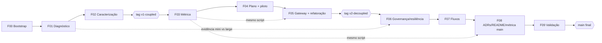

# Plano mestre de implementação: desafio "Da integração frágil à arquitetura resiliente"

> **Fonte de verdade:** `desafio_arquitetura_ia_helpdesk.md` (neste workspace) e o repositório base <https://github.com/devfullcycle/desafio-arquitetura-era-ia-1>. Quando este plano e o enunciado divergirem, vale o enunciado, e o plano deve ser corrigido.
>
> **Companheiro:** `acceptance-matrix.md` (rastreabilidade requisito → fase → teste → evidência).
>
> **Localização:** `docs/implementation-master-plan.md` e `docs/acceptance-matrix.md` no fork `tomxdev/desafio-arquitetura-era-ia-1` (copiados na F00 a partir do workspace). **Esta cópia é a oficial** e é a que recebe as atualizações de status.

## 0. Convenções

| Marcador | Significado |
|---|---|
| **[FATO]** | Observado e verificado (comando executado, arquivo lido). |
| **[ESCOLHA]** | Decisão já tomada (pelo usuário ou por este plano), com justificativa. |
| **[HIPÓTESE]** | Expectativa forte que **precisa** de evidência antes de virar decisão ou ADR. |
| **[PENDENTE]** | Ainda não pode ser confirmado; quem resolve é a fase indicada. |

- **Status de fase/item:** `pending` · `in_progress` · `blocked` · `done`.
- **Shell:** todos os comandos são para **Git Bash** no Windows (ou bash no Linux/CI). No PowerShell, `curl` é alias de `Invoke-WebRequest`; use `curl.exe` ou o Git Bash.
- **[FATO F01] Corpos com acento:** no Windows, `curl -d '{...não...}'` chega corrompido e a app responde `400 There was an error parsing the body`. Sempre enviar o corpo de arquivo: `--data-binary @scripts/diagnostics/payloads/<arquivo>.json`. Os `-d '...'` deste plano são ilustrativos.
- **Raiz do repo:** `C:\dev\desafio-arquitetura-era-ia-1` (no Git Bash: `/c/dev/desafio-arquitetura-era-ia-1`), daqui em diante `$REPO`.
- **Fork:** `tomxdev/desafio-arquitetura-era-ia-1` · **upstream:** `devfullcycle/desafio-arquitetura-era-ia-1`.
- **Evidências:** `docs/evidence/fNN/` no fork (texto: `.txt`, `.json`, `.csv`, `.log`; nada binário além dos gráficos de métrica).
- **Nenhuma medição deste plano é resultado real.** Números citados vêm do README do provider (declarados) ou são estimativas marcadas como **[HIPÓTESE]**.

### 0.1 Decisões do usuário já tomadas [ESCOLHA]

| # | Decisão | Consequência no plano |
|---|---|---|
| U1 | Clone em disco local `C:\dev\desafio-arquitetura-era-ia-1` | Evita bind mounts e `.git`/`.venv` dentro do Google Drive. |
| U2 | CI com GitHub Actions | A F00 exige `gh auth refresh -s workflow` (ação humana). |
| U3 | O agente faz o merge dos PRs `feature/* → develop` após gates verdes; **promoção para `main` e push de tags exigem confirmação explícita do usuário** | Toda fase de marco (F02, F05, F09) tem um ponto de parada obrigatório antes do merge na `main` e da tag. |

---

## 1. Inventário observado [FATO]

Verificado em 2026-10-13 via `gh api` (sem clone):

**Host**

| Ferramenta | Versão | Observação |
|---|---|---|
| git | 2.56.0.windows.1 | ok |
| gh | 2.101.0 | logado como `tomxdev`; escopos `gist, read:org, repo`; **falta `workflow`** |
| Docker | 29.7.2 | ok |
| Docker Compose | v5.5.0 | sucessor da linha v2 da CLI (`docker compose`); suporta `--wait` |
| Python | 3.12.10 (`py -3.12`) e 3.13.1 (`python`) | **usar 3.12 explicitamente** |
| uv | 0.12.19 | gerenciador de venv/deps no host |

**Repositório base** (default `main`, público, 1 commit `a1aedd76 initial commit`, ainda **sem fork** em `tomxdev`)

```
.env.example        FAKE_OPENAI_KEY=sk-fake-openai-0001 / FAKE_ANTHROPIC_KEY=sk-ant-fake-0001
.gitignore          node_modules/ __pycache__/ *.pyc .pytest_cache/ .env
compose.yaml        provider-fake (build, env_file .env, 8090:8090)
                    edge (nginx:1.27-alpine, 8000:80, depends_on app healthy)
                    app (build ./app, env_file .env, ./data:/data:ro, healthcheck python urllib /health)
app/Dockerfile      python:3.12-slim, uvicorn helpdesk.main:app --port 8080
app/requirements.txt fastapi==0.115.6 uvicorn==0.34.0 openai==3.19.0 anthropic==1.8.0
app/helpdesk/       __init__ main config llm schemas classification suggestion extraction report tickets
edge/nginx.conf     proxy_read_timeout 30s; proxy_send_timeout 30s; proxy_connect_timeout 5s;
                    proxy_http_version 1.1; **proxy_buffering NÃO desligado**
provider-fake/      app/{main,tasks}.py, tests/, README.md (não alterar)
data/               tickets.jsonl, generate.py (não alterar)
docs/adr/0000-template.md   campos: Status, Data, Nível, Contexto, Opções, Decisão, Consequências, Evidência
```

**Onde moram as dores no código v1** (referência para o diagnóstico; os números de linha são confirmados na F01):

| Dor | Causa provável | Arquivo |
|---|---|---|
| Relatório do mês morre em 504 | 34 chamadas sequenciais (5000/150) numa rota síncrona; borda corta aos 30 s sem byte | `app/helpdesk/report.py` (loop), `main.py` (`def topics_report`), `edge/nginx.conf` |
| Atendente 15 s sem ver nada | `messages.create` sem streaming; saída longa a 40 tok/s | `app/helpdesk/suggestion.py`, `llm.py` (`call_anthropic`) |
| Provider fora derruba metade do helpdesk | F1/F4 presas ao `openai`, F2/F3 ao `anthropic`; sem fallback; sem timeout explícito; retries padrão dos SDKs | `config.py` (modelos), `llm.py` (clientes sem `timeout`/`max_retries`) |
| Trocar modelo exige deploy | nomes físicos hardcoded; imagem com código embutido | `config.py` (`*_MODEL = "gpt-fake-large"` …) |
| Chaves na aplicação | `os.environ["FAKE_OPENAI_KEY"]`; `env_file: .env` no serviço `app` | `config.py`, `compose.yaml` |

**Provider simulado (declarado no `provider-fake/README.md`)**

| Modelo | TTFT | Velocidade | US$/1M in | US$/1M out |
|---|---|---|---|---|
| gpt-fake-large | 800 ms | 40 tok/s | 2,50 | 10,00 |
| gpt-fake-mini | 300 ms | 150 tok/s | 0,15 | 0,60 |
| claude-fake-large | 800 ms | 40 tok/s | 3,00 | 15,00 |
| claude-fake-mini | 300 ms | 150 tok/s | 0,80 | 4,00 |

Contexto de 8.000 tokens; tokens = `ceil(chars/4)`; saída determinística; `large` equivalentes entre si; modos `normal | error_500 | error_429 | timeout (segura 300 s) | slow (×10) | midstream_error`; `/admin/calls?last=N` registra **no recebimento** (inclui recusas do provider); LiteLLM testado com `ghcr.io/berriai/litellm:v1.102.1`; sem preço declarado o LiteLLM calcula custo zero.

**LiteLLM (Context7, docs atuais)** [FATO de documentação, comportamento real **[PENDENTE]** F05/F06]: `litellm_settings.num_retries`, `request_timeout`, `router_settings.fallbacks`, `retry_policy` por tipo de erro, `allowed_fails`/`cooldown_time`; no proxy, o `max_retries` do SDK do provider fica fixo em 0 (o retry é do router); `/key/generate` aceita `models`, `max_budget`, `rpm_limit`, `key_alias`, `budget_duration`.

### 1.1 Oráculo manual da métrica na v1 [HIPÓTESE: calculado à mão, o script da F03 precisa reproduzir]

Régua do requisito 3 aplicada a `app/helpdesk/` do repositório base (`__init__.py` excluído; dependência = import que resolve para outro componente):

| component | ca | ce | i | a | d | Imports que resolvem (Ce) / quem importa (Ca) |
|---|---|---|---|---|---|---|
| classification | 1 | 3 | 0.75 | 0 | 0.25 | config, llm, schemas / main |
| config | 6 | 0 | 0 | 0 | 1 | — / llm, classification, suggestion, extraction, report, tickets |
| extraction | 1 | 3 | 0.75 | 0 | 0.25 | config, llm, schemas / main |
| llm | 4 | 1 | 0.2 | 0 | 0.8 | config / classification, suggestion, extraction, report |
| main | 0 | 5 | 1 | 0 | 0 | classification, extraction, report, suggestion, schemas / — |
| report | 1 | 4 | 0.8 | 0 | 0.2 | config, llm, tickets, schemas / main |
| schemas | 5 | 0 | 0 | 0 | 1 | — / main, classification, suggestion, extraction, report |
| suggestion | 1 | 3 | 0.75 | 0 | 0.25 | config, llm, schemas / main |
| tickets | 1 | 1 | 0.5 | 0 | 0.5 | config / report |

Zona de dor na v1 (A < 0,5, I < 0,5, D ≥ 0,5): `config`, `llm`, `schemas`. `tickets` tem I = 0,5 (não é < 0,5), fica fora. `schemas` tem 7 classes, todas `BaseModel`, então A = 0.

---

## 2. Pré-voo e provisionamento

### 2.1 Ferramentas do host (verificação, não instalação)

```bash
git --version                       # ≥ 2.40
gh --version && gh auth status      # conta tomxdev; escopos repo + workflow
docker version --format '{{.Server.Version}}'
docker compose version              # precisa suportar --wait
py -3.12 --version                  # 3.12.x
uv --version                        # opcional; alternativa: py -3.12 -m venv
```

- Faltando `workflow` no gh → **ação humana**: `gh auth refresh -h github.com -s workflow`.
- Nada mais é instalado globalmente. Tudo o que for Python fica no venv `.venv/` do repo (no `.gitignore`).

### 2.2 Dependências, separadas por camada

| Camada | Onde | Conteúdo | Versionado em |
|---|---|---|---|
| Host | sistema | git, gh, Docker, Python 3.12, uv | `docs/evidence/f00/host-versions.txt` |
| Python do host (testes e métricas) | `.venv/` | `pytest`, `httpx` (testes); `matplotlib` (gráfico) | `tests/requirements.txt`, `metrics/requirements.txt` (versões fixadas) |
| Containers | compose | `nginx:1.27-alpine`, build `provider-fake`, build `app`; a partir da F05 `ghcr.io/berriai/litellm:<tag pinada>` e `postgres:<tag pinada>` | `compose.yaml` |

Bootstrap do venv:

```bash
cd $REPO
uv venv --python 3.12 .venv           # ou: py -3.12 -m venv .venv
source .venv/Scripts/activate         # Linux/CI: source .venv/bin/activate
uv pip install -r tests/requirements.txt -r metrics/requirements.txt   # quando existirem
```

### 2.3 Ambiente e segredos

- `cp .env.example .env` em toda máquina nova. `.env` já está no `.gitignore` do base [FATO], e não pode ser removido de lá.
- Os valores do `.env.example` **não são segredos reais** (só funcionam no provider-fake) e o enunciado exige que `cp .env.example .env` baste. Por isso, a partir da F05, o `.env.example` passa a carregar **também** `LITELLM_MASTER_KEY`, `HELPDESK_GATEWAY_KEY`, as chaves de demo e `POSTGRES_PASSWORD`, todos com valores fixos de laboratório. Isso é documentado em ADR como "segredos de laboratório".
- **Política de variáveis** (a partir da v2):
  - `FAKE_OPENAI_KEY` e `FAKE_ANTHROPIC_KEY` → só em `provider-fake` e `gateway`.
  - `app` → **sem `env_file`**; recebe por `environment:` só `GATEWAY_BASE_URL` e `HELPDESK_GATEWAY_KEY` (mais timeouts não sensíveis).
  - Verificação: `docker compose config` (bloco `app`) e `docker compose exec app env`.
- **Healthchecks:** todo serviço tem healthcheck, e `depends_on` usa `condition: service_healthy` (ou `service_completed_successfully` para jobs one-shot). Assim, `docker compose up -d --build --wait` é o único comando de subida.
- **Idempotência:** `docker compose down -v && docker compose up -d --build --wait` precisa funcionar repetidamente. A semeadura de chaves no gateway tolera chave já existente.

### 2.4 Imagens

```bash
docker pull nginx:1.27-alpine
docker pull python:3.12-slim
# a partir da F05 (tags confirmadas e pinadas na F05):
docker pull ghcr.io/berriai/litellm:v1.102.1     # versão testada pelo provider README
docker pull postgres:16-alpine                   # [PENDENTE] F05 confirma a tag
```

### 2.5 Bloqueios previstos e alternativas

| Bloqueio | Detecção | Alternativa | Precisa de humano? |
|---|---|---|---|
| gh sem escopo `workflow` | push de `.github/workflows/` rejeitado | `gh auth refresh -s workflow` | **Sim** |
| Fork já existe com outro nome | `gh repo list tomxdev --fork` | reutilizar e renomear remote; registrar | Sim, se o fork divergir do upstream |
| Docker Desktop parado | `docker version` falha | iniciar o Docker Desktop | Sim |
| Porta 8000/8090/4000 ocupada | `docker compose up` falha | liberar a porta; **não** mudar a 8000 (a borda é fixa) | Talvez |
| Pull do `ghcr.io` bloqueado | `docker pull` falha | tentar outra tag pública do mesmo projeto; registrar em ADR | Não |
| CI do Actions instável ou lento | job e2e falha sem relação com o código | re-run; evidência local anexada ao PR; não promover enquanto vermelho | Não |

---

## 3. Estratégia Git Flow e governança remota

### 3.1 Branches

| Branch | Origem | Destino | Uso |
|---|---|---|---|
| `main` | — | — | Só estados oficiais: v1 (tag `v1-coupled`), v2 (tag `v2-decoupled`) e final. |
| `develop` | `main` inicial (`a1aedd76`) | `release/*` | Integração. |
| `feature/NN-slug` | `develop` atualizada | `develop` | Uma por fase (ou subfase). |
| `release/v1-coupled`, `release/v2-decoupled`, `release/final` | `develop` | `main` | Validação do marco; só correções de validação entram aqui. |
| `hotfix/slug` | `main` | `main` + back-merge em `develop` | Só para corrigir marco publicado **antes** da tag; nunca reescrever uma tag publicada. |

Nomes concretos por fase:

| Fase | Branch | PR alvo | Título do PR |
|---|---|---|---|
| F00 | `feature/00-bootstrap` | develop | `[F00] Bootstrap: plano, matriz, CI e ambiente` |
| F01 | `feature/01-diagnostico-v1` | develop | `[F01] Diagnóstico da v1 (README + evidências)` |
| F02 | `feature/02-caracterizacao` | develop | `[F02] Testes de caracterização das 4 features` |
| F02 | `release/v1-coupled` | **main** | `[Release] v1-coupled` |
| F03 | `feature/03-metrica` | develop | `[F03] Script de métrica Ca/Ce/I/A/D + medição v1` |
| F04 | `feature/04-plano-piloto` | develop | `[F04] Plano de refatoração + piloto` |
| F05 | `feature/05-gateway-v2` | develop | `[F05] Gateway LiteLLM + desacoplamento (v2)` |
| F05 | `release/v2-decoupled` | **main** | `[Release] v2-decoupled` |
| F06 | `feature/06-governanca-resiliencia` | develop | `[F06] Governança, resiliência e fallback` |
| F07 | `feature/07-fluxos` | develop | `[F07] Modos de execução F1–F4` |
| F08 | `feature/08-adrs-docs` | develop | `[F08] ADRs, métricas finais e README` |
| F09 | `feature/09-validacao` (se houver correções) | develop | `[F09] Ajustes da validação end-to-end` |
| F09 | `release/final` | **main** | `[Release] versão final` |

### 3.2 Adaptação do Git Flow aos marcos [ESCOLHA]

1. **Merge sempre com merge commit** (`gh pr merge --merge --delete-branch`). Squash e rebase ficam **proibidos** (preservam rastreabilidade; nada é reescrito). No repo: `allow_squash_merge=false`, `allow_rebase_merge=false`.
2. **A tag vai no merge commit da `main`** gerado pelo PR `release/* → main`. Como a `main` só recebe releases, a árvore desse commit é idêntica à ponta da release. Tags **anotadas**: `git tag -a v1-coupled -m "..." <sha>`.
3. **Back-merge** `main → develop` por PR (`[Back-merge] main → develop após <marco>`) depois de cada release, para manter `develop` descendente da `main`.
4. **Gates de integração sequenciais:** a `develop` não recebe PRs de F03+ antes de `v1-coupled` publicada, nem de F07 (mudança de contrato) antes de `v2-decoupled` publicada. F06 entra **depois** da v2 (o mínimo da v2 é só o gateway com nomes lógicos e chave própria). Isso evita que `develop` carregue para um marco algo que o marco não deveria ter.
5. **Conflito com o enunciado:** o enunciado diz "trabalhe na `main` do seu fork". O plano satisfaz isso porque a `main` é a única branch com estado oficial e é para onde convergem todos os marcos. Se o avaliador olhar só a `main`, ela tem a versão final e as tags estão no histórico dela. Prevalece o enunciado: se alguma regra do Git Flow atrapalhar uma tag, a tag vence.

### 3.3 Convenção de commits

Conventional Commits, mensagem em português, escopo obrigatório:

```
docs(plan): adiciona plano mestre e matriz de aceite
docs(readme): registra diagnóstico da v1
test(characterization): fixa corpo das respostas de F1–F4
feat(metrics): calcula Ca/Ce/I/A/D pela régua do requisito 3
refactor(classification): injeta porta LLMGateway
feat(gateway): adiciona LiteLLM com capacidades lógicas
feat(f2): entrega sugestão por SSE
ci: adiciona jobs static e e2e
```

Todo commit termina com:

```
Co-Authored-By: Claude Opus 5.5 <noreply@anthropic.com>
```

Corpos de PR terminam com `🤖 Generated with [Claude Code](https://claude.com/claude-code)`.

### 3.4 Procedimento padrão de fase (P-FASE)

```bash
# 1. sincronizar
cd $REPO && git fetch origin --prune && git fetch upstream
git switch develop && git pull --ff-only origin develop
git status --porcelain              # precisa estar vazio
# 2. branch
git switch -c feature/NN-slug
# 3. ... mudanças da fase ...
# 4. gates locais (comandos da fase) + evidências em docs/evidence/fNN/
# 5. commit(s) pequenos e atômicos
git add <arquivos explícitos>       # nunca `git add -A` às cegas; nunca .env
git commit -m "tipo(escopo): resumo" -m "detalhes" -m "Co-Authored-By: Claude Opus 5.5 <noreply@anthropic.com>"
# 6. push e PR
git push -u origin feature/NN-slug
gh pr create --base develop --head feature/NN-slug --title "[FNN] ..." --body-file docs/evidence/fNN/pr-body.md
# 7. CI
gh pr checks --watch
# 8. merge remoto (agente, se gates verdes — decisão U3)
gh pr merge --merge --delete-branch
# 9. sincronizar local
git switch develop && git pull --ff-only origin develop
git branch -d feature/NN-slug
# 10. atualizar status na seção 7 deste plano (commit no próximo PR ou num PR docs curto)
```

### 3.5 Procedimento de release de marco (P-REL)

```bash
git switch develop && git pull --ff-only
git switch -c release/<marco>
# rodar TODOS os gates do marco (ver fase); correções só de validação
git push -u origin release/<marco>
gh pr create --base main --head release/<marco> --title "[Release] <marco>" --body-file docs/evidence/fNN/release-body.md
gh pr checks --watch
# >>> PARADA OBRIGATÓRIA: pedir confirmação explícita ao usuário (U3) <<<
gh pr merge --merge --delete-branch=false
git switch main && git pull --ff-only origin main
SHA=$(git rev-parse HEAD)
# gates pós-merge específicos do marco (ex.: app/ idêntico ao upstream na v1)
git tag -a <marco> -m "<descrição do marco>" "$SHA"
git push origin <marco>             # ou git push --tags, como o enunciado sugere
git ls-remote --tags origin | grep "refs/tags/<marco>"
# back-merge
gh pr create --base develop --head main --title "[Back-merge] main → develop após <marco>" --body "Sincroniza develop com o merge commit do marco."
gh pr merge --merge
```

### 3.6 Comandos de verificação de marcos

```bash
git diff --quiet upstream/main v1-coupled -- app/ && echo "app/ idêntico ao base"
git diff --exit-code v1-coupled v2-decoupled -- tests/characterization/ && echo "suíte idêntica"
git diff --quiet upstream/main main -- provider-fake/ edge/ data/ && echo "áreas proibidas intactas"
git ls-remote --tags origin                  # v1-coupled e v2-decoupled (e ^{} das anotadas)
git merge-base --is-ancestor v1-coupled v2-decoupled && git merge-base --is-ancestor v2-decoupled main
gh pr list --state merged --limit 50 --json number,title,baseRefName,mergedAt
```

### 3.7 Branch protection, rulesets, CI e reviews [ESCOLHA]

Repo público e solo. GitHub não deixa o autor aprovar o próprio PR, então **review obrigatório = 0**. O review é registrado como checklist no corpo do PR e no `/code-review` opcional do agente.

- `main` e `develop`: PR obrigatório, checks `static` e `e2e` obrigatórios, sem force-push, sem deleção, `enforce_admins=true`.
- Ruleset de tags `v*`: bloqueia update/delete (tags publicadas são imutáveis).
- Configuração do repo: `delete_branch_on_merge=true`, `allow_squash_merge=false`, `allow_rebase_merge=false`, `allow_merge_commit=true`.
- Os checks obrigatórios são ativados **depois** que o workflow rodou ao menos uma vez (F00 para `develop`, F02 para `main`).

Comandos (executados na F00/F02, não agora):

```bash
gh repo edit tomxdev/desafio-arquitetura-era-ia-1 --enable-squash-merge=false --enable-rebase-merge=false --enable-merge-commit --delete-branch-on-merge
gh api -X PUT repos/tomxdev/desafio-arquitetura-era-ia-1/branches/develop/protection --input .github/protection-develop.json
gh api -X POST repos/tomxdev/desafio-arquitetura-era-ia-1/rulesets --input .github/ruleset-tags.json
```

`.github/protection-*.json` (modelo):

```json
{"required_status_checks":{"strict":true,"contexts":["static","e2e"]},
 "enforce_admins":true,
 "required_pull_request_reviews":{"required_approving_review_count":0},
 "restrictions":null,"allow_force_pushes":false,"allow_deletions":false}
```

**CI (`.github/workflows/ci.yml`)**, em `pull_request` para `develop`/`main` e `push` em `main`:

- `static`:
  1. `git fetch https://github.com/devfullcycle/desafio-arquitetura-era-ia-1 main` → `git diff --exit-code FETCH_HEAD -- provider-fake edge data`.
  2. Se `gateway/` existe: `! grep -rE "gpt-fake|claude-fake" app/` e `! grep -rE "FAKE_OPENAI_KEY|FAKE_ANTHROPIC_KEY|sk-fake-openai|sk-ant-fake" app/`.
  3. Se `metrics/` existe: `pytest metrics/tests -q`.
- `e2e`: `cp .env.example .env` → `docker compose up -d --build --wait` → `curl -fsS localhost:8000/health` → suíte (`pytest tests/characterization -q`, e na `main` também `tests/contract`) → em falha, `docker compose logs` como artefato → `docker compose down -v`.

### 3.8 Checklists de PR

**Pré-merge (todo PR)**
- [ ] Branch criada a partir da `develop` atualizada; só arquivos do escopo da fase.
- [ ] `git diff origin/develop --stat` revisado; nenhuma mudança em `provider-fake/`, `edge/`, `data/`.
- [ ] `.env` não versionado (`git ls-files .env` vazio).
- [ ] Gates da fase executados localmente, com saída em `docs/evidence/fNN/`.
- [ ] CI `static` e `e2e` verdes (`gh pr checks`).
- [ ] Corpo do PR: objetivo, critérios cobertos (IDs da matriz), evidências, riscos, checklist.
- [ ] Matriz de aceite e status (seção 7) atualizados.

**Pós-merge**
- [ ] `git switch develop && git pull --ff-only` sem divergência.
- [ ] Branch remota apagada; local apagada.
- [ ] Para release: tag criada no SHA certo, `git ls-remote --tags origin` confirma, back-merge feito.
- [ ] URL real do PR registrada na seção 7 (nunca presumida).

---

## 4. Visão geral das fases

| Fase | Objetivo | Branch | PR alvo | Depende de | Entregáveis | Testes/gate principal | Marco | Status |
|---|---|---|---|---|---|---|---|---|
| F00 | Bootstrap, fork, CI, ambiente | feature/00-bootstrap | develop | — | fork, remotes, develop, docs do plano, CI, venv | compose sobe; `/health` 200; CI verde | — | done |
| F01 | Diagnóstico v1 | feature/01-diagnostico-v1 | develop | F00 | README "Diagnóstico da v1", `docs/evidence/f01/` | 4 dores reproduzidas; `app/` = upstream | — | done |
| F02 | Caracterização + v1 | feature/02-caracterizacao → release/v1-coupled | develop → main | F01 | `tests/characterization/`, tag | suíte verde na v1; `app/` idêntico | **v1-coupled** | done |
| F03 | Métrica | feature/03-metrica | develop | v1 publicada | `metrics/` + `results/v1-coupled.{csv,png}` | v1.csv = oráculo 1.1; unit tests | — | done |
| F04 | Plano + piloto | feature/04-plano-piloto | develop | F03 | `docs/refactoring-plan.md`, piloto | suíte verde; métrica antes/depois | — | done |
| F05 | Gateway + v2 | feature/05-gateway-v2 → release/v2-decoupled | develop → main | F04 | `gateway/`, compose, app refatorado, `results/v2-decoupled.*` | suíte **inalterada** verde; greps; env do app | **v2-decoupled** | done |
| F06 | Governança e resiliência | feature/06-governanca-resiliencia | develop | v2 publicada | budget, rpm, timeout, retry, fallback, troca de modelo | roteiros provados em `/admin/calls` | — | done |
| F07 | Fluxos F1–F4 | feature/07-fluxos | develop | F06 | sync/SSE/async, testes da main | tempos pela borda; sem 504 | — | done |
| F08 | ADRs, métrica final, README | feature/08-adrs-docs | develop | F07 | `docs/adr/*`, `results/main.*`, README | zona de dor; seções do README | — | done |
| F09 | Validação e release final | release/final | main | F08 | matriz 100% `done` | clone limpo + todos os critérios | **main final** | done |

### 4.1 Grafo de dependências e caminho crítico



Caminho crítico: **todo o grafo é sequencial**. Os gates mais caros de reverter são `V1` (tag imutável; `app/` idêntico) e `V2` (suíte idêntica, tudo via gateway). Trabalho que pode adiantar em paralelo, **sem merge antecipado**: rascunhos de ADR (em F05–F07, consolidados em F08) e o script de comparação de modelos (F01, usado em F06).

---

## 5. Fases

> Cada fase segue o template de 13 campos. "P-FASE" e "P-REL" referem-se às seções 3.4 e 3.5.

---

### F00 — Bootstrap e fork

**1. ID, título e objetivo.** F00 · Bootstrap e fork · Deixar o fork público, o clone local, os remotes, `develop`, CI, venv e o ambiente Docker prontos, com o plano versionado.

**2. Requisitos e critérios cobertos.** Tecnologias obrigatórias (Docker/Compose v2, Git, Python 3.12); Entregável ("fork público"); base para AC-RDM-02, AC-RDM-03. Matriz: TC-01, TC-02, ST-01.

**3. Pré-condições, dependências e estado Git.** Nenhuma fase anterior. Docker Desktop rodando. `gh auth status` ok. Fork inexistente [FATO em 2026-10-13]; reconfirmar.

**4. Branch / PR / marco.** `develop` criada da `main` do fork; trabalho em `feature/00-bootstrap` → PR para `develop`. Sem marco.

**5. Arquivos.**
- Criar: `.gitattributes`, `docs/implementation-master-plan.md`, `docs/acceptance-matrix.md`, `docs/evidence/f00/*`, `.github/workflows/ci.yml`, `.github/protection-develop.json`, `.github/protection-main.json`, `.github/ruleset-tags.json`.
- Alterar: `.gitignore` (acrescentar `.venv/`, `metrics/.cache/`, `*.egg-info/`, sem remover `.env`).
- **Proibido:** `app/` (até depois da tag v1), `provider-fake/`, `edge/`, `data/`, `compose.yaml`, `.env.example`, `README.md` (o README só muda na F01).

**6. Ações.**
1. Verificar ferramentas (seção 2.1) e salvar a saída em `docs/evidence/f00/host-versions.txt` (depois do clone).
2. Se `gh auth status` não listar `workflow`: **parar e pedir** ao usuário `! gh auth refresh -h github.com -s workflow`.
3. Reconfirmar fork: `gh repo view tomxdev/desafio-arquitetura-era-ia-1 --json isFork,parent,visibility 2>/dev/null`.
   - Inexistente → `gh repo fork devfullcycle/desafio-arquitetura-era-ia-1 --clone=false --default-branch-only`.
   - Existente → confirmar `isFork=true`, `parent=devfullcycle/...`, `visibility=PUBLIC` e que `main` == `upstream/main` (`a1aedd76`); se divergir, **parar e perguntar**.
4. `mkdir -p /c/dev && git clone https://github.com/tomxdev/desafio-arquitetura-era-ia-1.git /c/dev/desafio-arquitetura-era-ia-1`
5. `cd $REPO && git remote add upstream https://github.com/devfullcycle/desafio-arquitetura-era-ia-1.git && git fetch upstream && git remote -v`
   - **[FATO F00]** o Git do host tem `core.autocrlf=true`; o clone sai com CRLF, o que quebra scripts e configs montados em containers Linux. Correção local: `git config core.autocrlf false && git config core.eol lf && git rm -rq --cached . && git reset -q --hard`. Versionar `.gitattributes` com `* text=auto eol=lf` (`git ls-files --eol` confirmou que o índice já é todo LF, então nada é renormalizado).
6. Validar: `git rev-parse main upstream/main` (iguais), `gh repo view --json defaultBranchRef -q .defaultBranchRef.name` = `main`.
   - **[FATO F00]** num fork com remote `upstream`, o `gh` mira o repositório pai por padrão (`gh pr create` falha com "No commits between"). Rodar `gh repo set-default tomxdev/desafio-arquitetura-era-ia-1` uma vez por clone.
7. Configurar merges do repo (seção 3.7, `gh repo edit ...`).
8. `git switch -c develop main && git push -u origin develop`.
9. `git switch -c feature/00-bootstrap develop`.
10. Copiar `../implementation-master-plan.md` e `../acceptance-matrix.md` do workspace para `docs/`. Atualizar o cabeçalho de "Localização".
11. Criar `.github/workflows/ci.yml` (seção 3.7) e os JSONs de proteção.
12. `uv venv --python 3.12 .venv`; atualizar `.gitignore`.
13. `cp .env.example .env`; `docker compose up -d --build --wait`; `curl -s -o /dev/null -w '%{http_code}\n' localhost:8000/health` → `200`; salvar em `docs/evidence/f00/smoke.txt` (com `docker compose ps`).
14. `docker compose down` (sem `-v`; não há volumes ainda).
15. Commit, push, PR, `gh pr checks --watch`, merge (P-FASE).
16. Depois do primeiro run verde: aplicar a proteção de `develop` e o ruleset de tags (seção 3.7). Registrar o JSON retornado em `docs/evidence/f00/protection.json` (no PR da F01).

**7. Decisões arquiteturais.** Nenhuma de produto. Registrar no plano: clone local (U1), CI (U2), política de merge (U3), proteção com 0 approvals (trade-off: solo vs. governança).

**8. Testes e verificações.**
```bash
git remote -v                                  # origin=tomxdev, upstream=devfullcycle
git rev-parse main upstream/main               # mesmo SHA
gh repo view --json visibility,isFork -q '.visibility+" "+(.isFork|tostring)'   # PUBLIC true
docker compose up -d --build --wait && curl -fsS localhost:8000/health        # {"status":"ok"}
git ls-files .env                              # vazio
```

**9. Evidências.** `docs/evidence/f00/host-versions.txt`, `smoke.txt`, `protection.json`, URL do PR.

**10. Gate de pronto.** Fork público existe; `origin`/`upstream` corretos; `develop` publicada; plano e matriz em `docs/`; CI verde no PR; `/health` 200 pela borda; `.env` não versionado.

**11. Git/GitHub.** P-FASE; commits: `docs(plan): adiciona plano mestre e matriz de aceite`, `ci: adiciona jobs static e e2e`, `chore: ignora .venv`. PR `[F00] ...` → `develop`, merge pelo agente após checks.

**12. Riscos, rollback e retomada.** Escopo `workflow` ausente → bloqueio humano. Falha de CI no primeiro run → corrigir no próprio PR. Rollback: fechar o PR; `develop` sem mudanças. Retomar: `git -C $REPO status`, `gh pr list --head feature/00-bootstrap`, reler a seção 7.

**13. Prompt de execução.**
```text
Execute SOMENTE a fase F00 do plano em docs/implementation-master-plan.md (antes do clone: implementation-master-plan.md na raiz do workspace).
1) Releia a F00 e o estado real (gh auth status, gh repo view tomxdev/desafio-arquitetura-era-ia-1, docker version).
2) Se faltar o escopo 'workflow' no gh ou o fork existir divergente, PARE e peça ação humana.
3) Execute as ações 1–16 em ordem, salvando evidências em docs/evidence/f00/.
4) Valide o gate. Abra o PR para develop, aguarde o CI e, se verde, faça o merge com --merge.
5) Atualize a seção 7 (status=done, URL real do PR) e a matriz.
6) Reporte arquivos, comandos, saídas, commits e URL do PR. Não inicie a F01.
Nunca altere app/, provider-fake/, edge/, data/. Nunca declare PR/merge sem confirmar com gh.
```

---

### F01 — Reconhecimento e diagnóstico da v1

**1. ID, título e objetivo.** F01 · Diagnóstico da v1 · Exercitar F1–F4 pela borda, comparar large × mini, reproduzir as quatro dores com números observados e localizar as causas em `app/`, registrando tudo no README.

**2. Requisitos e critérios cobertos.** Req. 1 (todas as tarefas), fricções propositais 1–4; AC-DIAG-01; insumo para AC-ADR-03 (evidência mini) e AC-GW-06.

**3. Pré-condições.** F00 `done`; `develop` atualizada; compose sobe; `app/` == `upstream/main`.

**4. Branch / PR / marco.** `feature/01-diagnostico-v1` → `develop`. Sem marco, mas prepara a v1.

**5. Arquivos.**
- Criar: `docs/evidence/f01/**`, `scripts/diagnostics/compare_models.py`, `scripts/diagnostics/pains.sh`.
- Alterar: `README.md` (substituir pelo README do aluno com "Visão geral" provisória e **"Diagnóstico da v1"**, mais um link para o enunciado no repo base).
- **Proibido (permanente):** `app/`. A única exceção é a **alteração temporária** da dor 4, que **não é commitada** e é revertida na mesma sessão. Também proibidos `provider-fake/`, `edge/`, `data/`.

**6. Ações.**
1. P-FASE (sync, branch). `cp .env.example .env` se preciso. `docker compose up -d --build --wait`. `curl -s -X POST localhost:8090/admin/reset`.
2. **Leitura:** `provider-fake/README.md`, `edge/nginx.conf`, todo `app/helpdesk/*.py`. Anotar `arquivo:linha` de cada causa.
3. **Padrões dos SDKs (fricção 3):**
   ```bash
   docker compose exec app python -c "import openai,anthropic;print('openai',openai.__version__,openai.DEFAULT_MAX_RETRIES,openai.DEFAULT_TIMEOUT);print('anthropic',anthropic.__version__,anthropic.DEFAULT_MAX_RETRIES,anthropic.DEFAULT_TIMEOUT)" | tee docs/evidence/f01/sdk-defaults.txt
   ```
4. **F1–F4 pela borda (modo normal)**, cada um com `-w '\nstatus=%{http_code} ttfb=%{time_starttransfer} total=%{time_total}\n'`, salvando corpo + tempos em `docs/evidence/f01/features/fN.txt` e `curl -s "localhost:8090/admin/calls?last=5"` logo depois. F3 com um período curto (`2026-08-01`→`2026-08-01`) para ter um caso que termina.
5. **Large × mini direto no provider:** `scripts/diagnostics/compare_models.py` (httpx, lê `data/tickets.jsonl` só para leitura, amostra fixa e determinística, ex.: 30 primeiros tickets) chama `classify`, `extract`, `suggest` e `topics` (1 lote) nos 4 modelos e grava `docs/evidence/f01/models-compare/{task}.csv` (ticket, saída por modelo, divergência large×mini, tokens, duração) e um `summary.md` com taxas de divergência por tarefa. **[HIPÓTESE]** a divergência mais grave aparece em `extract` (`order_number`/`product`) e/ou `classify`. A F01 só registra o fato observado.
6. **Dor 1 (relatório do mês):**
   ```bash
   curl -s -X POST localhost:8090/admin/reset
   time curl -s -o docs/evidence/f01/pain1-body.txt -w 'status=%{http_code} total=%{time_total}\n' \
     -X POST localhost:8000/reports/topics -H 'Content-Type: application/json' -d '{"start":"2026-08-01","end":"2026-08-31"}'
   for i in $(seq 1 12); do date -u +%T; curl -s "localhost:8090/admin/calls?last=50" | python -c "import sys,json;c=json.load(sys.stdin);print(sum(1 for x in c if x['task']=='topics'))"; sleep 15; done | tee docs/evidence/f01/pain1-calls-after-504.txt
   ```
   Esperado **[HIPÓTESE]**: `504` em ~30 s; chamadas `topics` continuam crescendo depois do 504 (desistir ≠ cancelar). Calcular o custo dos tokens pagos depois do 504 com os preços do README.
   (O loop usa `sleep` em script de shell do usuário/agente; se o ambiente bloquear `sleep`, usar o Monitor.)
7. **Dor 2 (sugestão sem nada na tela):** `curl -sN -w 'ttfb=%{time_starttransfer} total=%{time_total}\n' -X POST localhost:8000/tickets/reply-suggestion ...` → ttfb ≈ total (≈15 s **[HIPÓTESE]**), resposta inteira de uma vez.
8. **Dor 3 (provider fora):**
   - `POST /admin/failures {"provider":"openai","mode":"error_500"}` → F1 e F4 falham (status observado), F2/F3 seguem ok; `/admin/calls` mostra **1 + retries do SDK** chamadas por requisição.
   - `{"provider":"openai","mode":"timeout"}` → F1 fica pendurada até a borda devolver `504` aos ~30 s (o SDK esperaria 600 s **[HIPÓTESE]**, confirmar com o passo 3).
   - Repetir para `anthropic` com F2. Salvar tudo em `docs/evidence/f01/pain3-*.txt`. Reset no fim.
9. **Dor 4 (troca de modelo exige deploy), alteração temporária:**
   ```bash
   sed -i 's/CLASSIFICATION_MODEL = "gpt-fake-large"/CLASSIFICATION_MODEL = "gpt-fake-mini"/' app/helpdesk/config.py
   docker compose restart app && <chamar F1> && curl -s "localhost:8090/admin/calls?last=1"   # ainda large (código está na imagem)
   docker compose up -d --build --wait app && <chamar F1> && curl -s "localhost:8090/admin/calls?last=1"   # agora mini
   git checkout -- app/ && docker compose up -d --build --wait app
   git diff --quiet upstream/main -- app/ && echo "app/ restaurado"
   ```
   Registrar `docker inspect -f '{{.Image}} {{.State.StartedAt}}'` antes e depois (rebuild + restart do app).
10. Escrever o README: "Visão geral" (provisória, marcada como v1) e "Diagnóstico da v1" com uma tabela por dor: **comando**, **observado** (status, tempo, trecho do `/admin/calls`), **causa** (`app/helpdesk/<arq>.py:<linha>` + config da borda/SDK).
11. Gates, commit, PR, merge.

**7. Decisões.** Nenhuma decisão de arquitetura ainda. Registrar **fatos** que alimentam os ADRs: tempos medidos, comportamento dos SDKs e divergência mini × large por tarefa.

**8. Testes e verificações.**
```bash
git diff --quiet upstream/main -- app/ && echo OK          # obrigatório
grep -n "Diagnóstico da v1" README.md
ls docs/evidence/f01/
```

**9. Evidências.** `docs/evidence/f01/{sdk-defaults.txt, features/*.txt, models-compare/*.csv, models-compare/summary.md, pain1-*.txt, pain2-*.txt, pain3-*.txt, pain4-*.txt}`.

**10. Gate de pronto.** As quatro dores têm comando, observação com números reais e causa com `arquivo:linha`; `app/` idêntico ao upstream; comparação mini × large concluída para as 4 tarefas.

**11. Git/GitHub.** Commits: `docs(readme): registra diagnóstico da v1`, `chore(diagnostics): script de comparação large x mini`, `docs(evidence): evidências da F01`. PR `[F01]` → `develop`; merge pelo agente.

**12. Riscos, rollback e retomada.** Esquecer de reverter a dor 4 → gate `git diff --quiet upstream/main -- app/` bloqueia. Medições variam por máquina → registrar o host. Rollback: fechar o PR. Retomar: checar quais `pain*.txt` existem e refazer só os que faltam.

**13. Prompt de execução.**
```text
Execute SOMENTE a fase F01 de docs/implementation-master-plan.md.
Pré-condição: F00 done; app/ idêntico a upstream/main. Siga as ações 1–11.
Toda medição de latência é pela borda localhost:8000. Use /admin/calls como prova.
A alteração de app/ da dor 4 é temporária: reverta, reconstrua e prove com `git diff --quiet upstream/main -- app/` antes de commitar.
Não invente números: registre somente saídas reais em docs/evidence/f01/.
Valide o gate, abra o PR para develop, aguarde o CI, faça o merge se verde, atualize a seção 7 e a matriz, reporte e PARE.
```

---

### F02 — Caracterização e tag `v1-coupled`

**1. ID, título e objetivo.** F02 · Caracterização + v1 · Fixar o comportamento observado da v1 (corpo das respostas e erros de entrada) numa suíte HTTP e publicar a tag `v1-coupled` no commit exato em que `app/` é o do base.

**2. Requisitos e critérios cobertos.** Req. 2 inteiro; AC-DIAG-02, AC-DIAG-03 (parte v1); RQ-2.x.

**3. Pré-condições.** F01 `done`; `develop` atualizada; compose ok.

**4. Branch / PR / marco.** `feature/02-caracterizacao` → `develop`; depois `release/v1-coupled` → `main`; tag **`v1-coupled`**.

**5. Arquivos.**
- Criar: `tests/requirements.txt` (`pytest`, `httpx` com versões fixadas), `tests/characterization/{conftest.py, test_f1_classification.py, test_f2_suggestion.py, test_f3_topics.py, test_f4_extraction.py, golden/*.json}`, `pytest.ini` (ou `[tool.pytest.ini_options]` em `pyproject.toml`), `docs/evidence/f02/*`.
- Alterar: `README.md` (seção "Como rodar": comando único da suíte).
- **Proibido:** `app/` (nenhuma mudança), `provider-fake/`, `edge/`, `data/`.

**6. Ações.**
1. P-FASE.
2. `conftest.py`: `BASE_URL = os.getenv("HELPDESK_BASE_URL", "http://localhost:8000")`, `PROVIDER_URL = os.getenv("PROVIDER_ADMIN_URL", "http://localhost:8090")`; fixture `autouse` que faz `POST /admin/reset` antes de cada teste; cliente `httpx.Client(timeout=60)` (acima dos 30 s da borda).
3. **Casos de sucesso** (golden JSON gravados de respostas reais da v1, comparação por igualdade do JSON inteiro):
   - F1: `TK-00042` / texto do enunciado → `{"ticket_id","category","priority"}`; + 1 ticket de outra categoria.
   - F2: um ticket → `{"ticket_id","suggestion"}` com o texto **completo** (o provider é determinístico).
   - F3: período **curto** que termina antes de 30 s pela borda (candidato `2026-08-01`→`2026-08-01`; a F01 mede o tempo) → `start`, `end`, `total_tickets`, `topics` completos.
   - F4: ticket com pedido (`#481516`) e ticket sem pedido (`order_number: null`).
   - Para todos: `status 200` e `Content-Type: application/json`.
4. **Casos de erro de entrada (≥1 por feature):** body sem `text` → `422`; `text: ""` → `422` (`min_length=1`); F3 `start > end` → `422` com `{"detail":"A data inicial é posterior à data final"}`; F3 data inválida → `422`. Fixar `detail[*].loc` e `detail[*].type` (não o `url` de documentação do pydantic, que é instável entre versões; justificar no docstring).
5. Gerador de golden (`tests/characterization/_record.py`, executado uma vez na v1 e commitado junto) **ou** golden escrito à mão a partir das saídas; documentar como foram obtidos.
6. Rodar a suíte 2× seguidas (determinismo) e salvar a saída em `docs/evidence/f02/pytest-v1.txt`.
7. README "Como rodar": `cp .env.example .env && docker compose up -d --build --wait` e `python -m pytest tests/characterization -q`.
8. PR `[F02]` → `develop`; merge.
9. **P-REL v1:** `release/v1-coupled` a partir da `develop`; gates do marco:
   ```bash
   git diff --quiet upstream/main -- app/ && echo "app/ idêntico"
   git diff --quiet upstream/main -- provider-fake/ edge/ data/
   docker compose down -v && docker compose up -d --build --wait && python -m pytest tests/characterization -q
   ```
10. PR `[Release] v1-coupled` → `main`; CI verde; **parar e pedir confirmação ao usuário**; merge; `git tag -a v1-coupled -m "v1: aplicação recebida + suíte de caracterização"`; `git push origin v1-coupled`; verificar remoto; back-merge.
11. Ativar a proteção da `main` (seção 3.7).

**7. Decisões.** Escopo da suíte: só comportamento observável em **modo normal + erros de entrada**. Comportamento sob falha do provider **não** é fixado, porque vai mudar de propósito na v2+ (fallback) e quebraria a igualdade entre tags. Trade-off: menos cobertura de falha na suíte de caracterização; a cobertura de falha fica nos testes da `main` (F06/F07).

**8. Testes e verificações.** `python -m pytest tests/characterization -q` → todos verdes, 2 execuções; tempo total registrado. Pós-tag: `git rev-parse v1-coupled^{commit}` == merge commit; `git diff --quiet upstream/main v1-coupled -- app/`.

**9. Evidências.** `docs/evidence/f02/{pytest-v1.txt, golden-origin.md, release-v1-checks.txt}`, URLs dos PRs, `git ls-remote --tags origin` em `docs/evidence/f02/tags.txt` (no back-merge ou no PR da F03).

**10. Gate de pronto.** Suíte verde contra a v1 pelo compose; corpo fixado nas 4 features; ≥1 erro de entrada por feature; `app/` idêntico ao base no commit da tag; tag publicada e visível remotamente.

**11. Git/GitHub.** Commits `test(characterization): ...`, `docs(readme): comando da suíte`. PRs: `[F02]` (agente faz o merge), `[Release] v1-coupled` (**confirmação humana**), `[Back-merge]`.

**12. Riscos, rollback e retomada.** F3 de 1 dia passar de 30 s → escolher outro dia com menos tickets (medir) e documentar. Flakiness de tempo → só limites folgados na caracterização (sem asserts de latência). Tag errada **antes** do push → `git tag -d` e recriar; **depois** do push → não reescrever: abrir `hotfix/` e discutir com o usuário (o ruleset impede apagar). Retomar: `git tag -l v1-coupled`, `git ls-remote --tags origin`, `gh pr list --base main`.

**13. Prompt de execução.**
```text
Execute SOMENTE a fase F02 de docs/implementation-master-plan.md.
Escreva tests/characterization/ fixando o CORPO das respostas de F1–F4 da v1 (golden de respostas reais) + ≥1 erro de entrada por feature, rodando contra localhost:8000 com /admin/reset entre testes.
Não altere app/. Rode a suíte 2x. PR para develop → merge se verde.
Depois faça P-REL v1: release/v1-coupled → PR para main, gates do marco e PARE pedindo confirmação explícita do usuário antes do merge e da tag.
Com confirmação: merge --merge, tag anotada v1-coupled no merge commit, git push origin v1-coupled, confirme com git ls-remote, back-merge.
Atualize a seção 7 e a matriz, reporte as URLs reais e PARE.
```

---

### F03 — Métrica inicial (Ca, Ce, I, A, D)

**1. ID, título e objetivo.** F03 · Métrica · Script que mede `app/helpdesk/` de qualquer checkout pela régua do req. 3, gera CSV + gráfico A × I e mede a `v1-coupled`.

**2. Requisitos e critérios cobertos.** Req. 3; AC-MET-01 (v1), AC-MET-02, AC-MET-03.

**3. Pré-condições.** `v1-coupled` publicada e back-merge feito (**o script nasce depois da tag**).

**4. Branch / PR / marco.** `feature/03-metrica` → `develop`.

**5. Arquivos.**
- Criar: `metrics/coupling.py`, `metrics/requirements.txt` (`matplotlib` fixado), `metrics/tests/{test_coupling.py, fixtures/**}`, `metrics/results/v1-coupled.csv`, `metrics/results/v1-coupled.png`, `metrics/README.md` (opcional, curto).
- **Proibido:** `app/`, áreas protegidas.

**6. Ações.**
1. P-FASE.
2. `metrics/coupling.py` (stdlib `ast` + `matplotlib`):
   - CLI: `python metrics/coupling.py <caminho/para/app/helpdesk> --name <rotulo> [--out-dir metrics/results]` → `<rotulo>.csv` e `<rotulo>.png`.
   - Descoberta: todo `*.py` sob o caminho, recursivo, exceto `__init__.py`; componente = caminho relativo com pontos e sem `.py` (`adapters/gateway.py` → `adapters.gateway`).
   - Resolução de imports:
     - `import helpdesk.x.y` / `from helpdesk.x import y` → absoluto com o nome do pacote raiz = nome da pasta medida (`helpdesk`).
     - `from . import a, b` → cada nome `a` vira candidato `<pacote>.a`; se não for componente, tenta o próprio pacote (excluído, `__init__`) → ignora.
     - `from .x import Y` / `from ..ports import Gateway` → resolve o nível relativo a partir do pacote do arquivo; o alvo é `x` (e `x.Y` se `Y` for um submódulo componente).
     - Imports para não componentes (stdlib, terceiros, `__init__`) não contam; autoimport não conta; dependências contadas como **conjunto** (sem duplicata).
     - Imports dentro de funções e em `if TYPE_CHECKING:` **contam** (são imports). Documentar a regra no ADR da métrica.
   - Classes: todo `ClassDef` do módulo (top-level e aninhadas; documentar); abstrata se alguma base, direta, for `Protocol`, `typing.Protocol`, `ABC`, `abc.ABC` (inclui `Generic`+`Protocol`). **[PENDENTE]** herança indireta de uma classe abstrata local: a régua diz "herdam de Protocol ou ABC". Interpretar como base direta e declarar no ADR.
   - `I = Ce/(Ce+Ca)` ou 0; `A = abstratas/total` ou 0; `D = |A+I-1|`; `round(x, 2)`; CSV com header exato `component,ca,ce,i,a,d`, linhas ordenadas por `component`, números formatados sem notação científica (`0.75`, `1`, `0`; **fixar o formato** para comparar byte a byte entre execuções: usar `f"{v:g}"` após o round ou sempre 2 casas. Escolher um e documentar).
   - Gráfico: dispersão I (x) × A (y), reta da Main Sequence `A + I = 1`, zonas de dor (canto 0,0) e de inutilidade (1,1) sombreadas, rótulo por ponto, título com o rótulo da versão, `savefig(dpi=120)`, backend `Agg`.
3. Testes unitários (`metrics/tests`): fixtures mínimas cobrindo import relativo de vários níveis, `from . import`, absoluto, stdlib ignorada, subpasta, `__init__` excluído, Protocol/ABC, módulo sem classes, Ca=Ce=0. E um teste de **oráculo** que roda contra uma cópia **imutável** do `app/helpdesk` da v1 em fixture (ou via `git show v1-coupled:...`) e compara com a tabela 1.1.
4. Medir a v1:
   ```bash
   git worktree add ../v1 v1-coupled
   python metrics/coupling.py ../v1/app/helpdesk --name v1-coupled
   git worktree remove ../v1
   ```
5. Conferir manualmente 3 módulos contra a tabela 1.1 (`config`, `llm`, `report`) e registrar em `docs/evidence/f03/manual-check.md`.
6. README: em "Como rodar", o comando da métrica. Em "Métrica", o rascunho da leitura da v1.
7. Gates, PR, merge.

**7. Decisões.** Régua fixa (sem alternativas). Decisões de interpretação: imports condicionais/locais contam; classes aninhadas contam; abstrata = base direta Protocol/ABC; formato numérico do CSV. Vão para o **ADR da métrica** (rascunho aqui, final na F08), nível **software**.

**8. Testes e verificações.**
```bash
python -m pytest metrics/tests -q
head -1 metrics/results/v1-coupled.csv | grep -qx 'component,ca,ce,i,a,d'
# reprodutibilidade (recria o worktree, removido na ação 4):
git worktree add ../v1 v1-coupled && python metrics/coupling.py ../v1/app/helpdesk --name tmp --out-dir /tmp/m && diff /tmp/m/tmp.csv metrics/results/v1-coupled.csv; git worktree remove ../v1
```

**9. Evidências.** `metrics/results/v1-coupled.{csv,png}`, `docs/evidence/f03/{pytest-metrics.txt, manual-check.md}`.

**10. Gate de pronto.** CSV da v1 igual à tabela 1.1 (ou divergência explicada **e** a tabela 1.1 corrigida com a conta à mão); testes verdes; gráfico com a Main Sequence; header exato.

**11. Git/GitHub.** Commits `feat(metrics): ...`, `test(metrics): ...`, `docs(metrics): resultado v1`. PR `[F03]` → `develop`; merge pelo agente.

**12. Riscos, rollback e retomada.** Divergência com o avaliador por interpretação de `from . import x` → coberta por teste e pelo ADR. `matplotlib` sem backend no Windows → forçar `Agg`. Retomar: `git worktree list` (remover worktrees órfãos com `git worktree prune`).

**13. Prompt de execução.**
```text
Execute SOMENTE a fase F03 de docs/implementation-master-plan.md.
Implemente metrics/coupling.py seguindo EXATAMENTE a régua do requisito 3 (copie-a para o docstring), com testes unitários e o teste de oráculo da tabela 1.1.
Meça a v1 via `git worktree add ../v1 v1-coupled` e versione metrics/results/v1-coupled.{csv,png}.
Não altere app/. Não ajuste a régua ao resultado. PR para develop, merge se verde, atualize status/matriz, reporte e PARE.
```

---

### F04 — Plano de refatoração e piloto

**1. ID, título e objetivo.** F04 · Plano + piloto · Escrever `docs/refactoring-plan.md`, executar o piloto em **um** componente com medição antes e depois e revisar o plano com base no resultado.

**2. Requisitos e critérios cobertos.** Req. 4 (plano, piloto, revisão, handoff); AC-PLAN-01 (parcial: handoff completo na F05).

**3. Pré-condições.** F03 `done`; `metrics/results/v1-coupled.csv` versionado.

**4. Branch / PR / marco.** `feature/04-plano-piloto` → `develop`.

**5. Arquivos.**
- Criar: `docs/refactoring-plan.md`, `docs/evidence/f04/*`.
- Alterar: o componente do piloto e o que for estritamente necessário em `app/helpdesk/` (ex.: novo `ports.py`, `classification.py`, `main.py`).
- **Proibido:** mudar contratos HTTP; mudar `tests/characterization/`; áreas protegidas; introduzir o gateway (fica na F05).

**6. Ações.**
1. P-FASE.
2. Escrever o plano (`docs/refactoring-plan.md`):
   - **Ponto de partida:** a tabela da v1 e a zona de dor (`config`, `llm`, `schemas`).
   - **Componentes-alvo e estratégia** (rascunho inicial; a revisão vem depois):

     | Alvo | Problema medido | Estratégia | Resultado esperado [HIPÓTESE] |
     |---|---|---|---|
     | `llm` | Ca=4, I=0,2, A=0 (concreto e muito usado) | **inverter a dependência**: `ports.LLMGateway` (Protocol) consumida pelas features; implementação concreta única em `adapters.gateway`, importada só por `main` | `ports`: A=1, I≈0 → D≈0; `adapters.gateway`: Ca=1 → I≥0,5 |
     | `config` | Ca=6, D=1 | **reduzir Ca**: as features recebem parâmetros por construtor/injeção; só o ponto de composição lê configuração; nomes físicos saem do app | `config` some ou só é importada por `main` |
     | features (`classification`, `suggestion`, `extraction`, `report`) | dependem de `llm` e `config` concretos | dependem só de `ports` + `schemas`; **compor em vez de herdar** (recebem o gateway) | Ce só para abstrações |
     | `tickets` | I=0,5 | porta `TicketSource` (opcional, se a métrica e a testabilidade justificarem) | — |
     | `schemas` | D=1 (tipos de valor) | **não mexer**: candidato a "estável por natureza" | exceção declarada no ADR |
   - **Critério de pronto:** na v2/main, nenhum componente na zona de dor (A<0,5 ∧ I<0,5 ∧ D≥0,5) exceto exceções declaradas e justificadas (nunca features nem o cliente do gateway); o cliente do gateway num único componente; nenhuma feature importa esse componente; suíte de caracterização verde **sem alteração**.
   - **Armadilhas da fórmula** (registrar, sem projetar para ela): qualquer módulo concreto folha (Ce=0) com Ca≥1 cai em I=0 → D=1. Logo, exceções de domínio, settings e repositórios concretos precisam ser posicionados por responsabilidade (composição em `main`, exceções junto às portas ou em módulo de domínio declarado estável), e isso é justificado no ADR, não feito "por import".
3. **Piloto em `classification`** [ESCOLHA, por ser a feature mais simples]:
   - Medir antes (`python metrics/coupling.py app/helpdesk --name pilot-before --out-dir docs/evidence/f04`).
   - Criar `app/helpdesk/ports.py` com `class LLMGateway(Protocol): def complete(self, capability: str, task: str, content: str, *, max_tokens: int | None = None) -> str: ...`.
   - `classification.classify(ticket, gateway: LLMGateway)` (ou classe `Classifier(gateway)`); a capacidade é recebida como **nome lógico** e o mapeamento lógico→físico fica, provisoriamente, num adaptador sobre o `llm.py` atual (ainda direto ao provider; a F05 troca para o gateway).
   - `main.py` monta a dependência (ponto de composição).
   - Suíte de caracterização verde; medir depois (`--name pilot-after`).
4. Registrar no plano a tabela antes × depois do piloto e a **revisão**: o que o piloto mostrou (ex.: o adaptador provisório herdou o Ca do `config`; o nome da operação na porta; se a porta deve aceitar `stream` já na v2 ou só na F07) e o que mudou no plano.
5. Registrar o **protocolo de handoff** que a F05 vai usar: o que se entrega ao agente (enunciado do req. 4, plano revisado, CSV, suíte, áreas proibidas), como se aceita/rejeita (suíte verde inalterada + métrica dentro do critério + greps), quantas iterações e um log de decisões.
6. Gates, PR, merge.

**7. Decisões.** Escolha do componente do piloto (classification: menor raio de impacto); formato da porta; onde vive o mapeamento lógico→físico antes do gateway. Trade-off: adaptador provisório (débito transitório) vs. piloto já com gateway (piloto maior, mistura de riscos).

**8. Testes e verificações.** `python -m pytest tests/characterization -q` verde; `git diff --exit-code v1-coupled -- tests/characterization/`; métrica antes/depois gerada.

**9. Evidências.** `docs/evidence/f04/{pilot-before.csv,png, pilot-after.csv,png, pytest.txt}`, tabela no plano.

**10. Gate de pronto.** O plano contém alvos, estratégia por alvo, critério de pronto, piloto com antes/depois, ≥1 revisão justificada e o protocolo de handoff; suíte verde e inalterada.

**11. Git/GitHub.** Commits `docs(refactoring): plano inicial`, `refactor(classification): injeta porta LLMGateway (piloto)`, `docs(refactoring): medição do piloto e revisão`. PR `[F04]` → `develop`.

**12. Riscos, rollback e retomada.** O piloto quebrar a suíte → reverter o commit do piloto (`git revert`), ajustar o plano, repetir. Retomar: ver se `docs/evidence/f04/pilot-after.csv` existe.

**13. Prompt de execução.**
```text
Execute SOMENTE a fase F04 de docs/implementation-master-plan.md.
Escreva docs/refactoring-plan.md (alvos, estratégia, critério de pronto baseado na métrica), meça antes, faça o piloto SÓ em classification (porta Protocol + injeção no ponto de composição), rode a suíte de caracterização SEM alterá-la, meça depois, registre a revisão do plano e o protocolo de handoff.
Não introduza o gateway ainda. Não mude contratos HTTP. PR para develop, merge se verde, atualize status/matriz, reporte e PARE.
```

---

### F05 — Gateway e desacoplamento (tag `v2-decoupled`)

**1. ID, título e objetivo.** F05 · Gateway + v2 · Colocar um AI Gateway self-hosted (serviço `gateway`) na frente dos providers, com nomes lógicos e chave do próprio gateway, escalar a refatoração com um agente de IA e publicar `v2-decoupled` sem mudar o comportamento externo.

**2. Requisitos e critérios cobertos.** Req. 4 (gateway mínimo, refatoração com agente, métrica v2, tag); Req. 5 (capacidades lógicas, credenciais fora); restrições (toda chamada via gateway; sem chaves no app); AC-PLAN-01 (handoff), AC-PLAN-02, AC-DIAG-03 (v2), AC-DIAG-04, AC-MET-01 (v2), AC-GW-01, AC-GW-02.

**3. Pré-condições.** F04 `done`; plano revisado; suíte verde.

**4. Branch / PR / marco.** `feature/05-gateway-v2` → `develop` (pode ser dividida em `feature/05a-gateway-infra` e `feature/05b-refatoracao`, ambas → `develop`); depois `release/v2-decoupled` → `main`; tag **`v2-decoupled`**.

**5. Arquivos.**
- Criar: `gateway/config.yaml`, `gateway/seed_keys.py` ou `gateway/entrypoint.sh` (ver decisão), `app/helpdesk/adapters/__init__.py`, `app/helpdesk/adapters/gateway.py`, `docs/adr/0001-*.md` a `0003-*.md` (rascunhos), `metrics/results/v2-decoupled.{csv,png}`, `docs/evidence/f05/*`.
- Alterar: `compose.yaml` (`gateway`, `gateway-db`; `app` sem `env_file`, com `environment:`, `depends_on: gateway: service_healthy`), `.env.example` (variáveis do gateway), `app/requirements.txt` (remover `anthropic`; manter `openai` como cliente HTTP compatível do gateway; **fixar `pydantic==2.14.1` e `pydantic_core==2.50.1`**, ver R14), `app/helpdesk/{config,llm,main,classification,suggestion,extraction,report,tickets}.py` conforme o plano, `docs/refactoring-plan.md` (handoff, medições), `README.md` (Como rodar, componente do cliente do gateway).
- **Proibido:** `tests/characterization/**` (nenhum byte), `provider-fake/`, `edge/`, `data/`; mudar rotas, modos de resposta ou corpos; usar modelo `mini` em qualquer capacidade.

**6. Ações.**
1. P-FASE.
2. **Infra do gateway** [ESCOLHA: LiteLLM Proxy, sugerido pelo enunciado e testado pelo provider README]:
   - `gateway-db`: `postgres:16-alpine` (tag confirmada e pinada), `POSTGRES_*` de laboratório, healthcheck `pg_isready`, volume nomeado.
   - `gateway`: `ghcr.io/berriai/litellm:v1.102.1` (ou a tag estável confirmada; **pinada**), `command: ["--config", "/etc/litellm/config.yaml", "--port", "4000"]`, `volumes: ./gateway:/etc/litellm:ro` (**diretório**, não arquivo único, para a edição da troca de modelo aparecer no container), `environment`: `DATABASE_URL`, `LITELLM_MASTER_KEY`, `FAKE_OPENAI_KEY`, `FAKE_ANTHROPIC_KEY`, `STORE_MODEL_IN_DB=False`; `ports: "4000:4000"` (para o roteiro de governança no host); healthcheck via Python da imagem (`/health/liveliness`; **[PENDENTE]** confirmar endpoint e se há `curl` na imagem).
   - `gateway/config.yaml`, capacidades lógicas (todas em `large` na v2):

     | Capacidade | Feature | Primário (v2) |
     |---|---|---|
     | `helpdesk-classify` | F1 | `openai/gpt-fake-large` |
     | `helpdesk-suggest` | F2 | `anthropic/claude-fake-large` |
     | `helpdesk-topics` | F3 | `anthropic/claude-fake-large` |
     | `helpdesk-extract` | F4 | `openai/gpt-fake-large` |

     com `api_base` do provider-fake e `api_key: os.environ/FAKE_*`. Na v2, **sem** fallback/budget obrigatórios (vêm na F06), mas com `num_retries: 0` explícito para não mudar a contagem de chamadas sem decisão.
   - **Virtual key do app sem passo manual** [PENDENTE, decidir por evidência]:
     - (a) **preferida**: `gateway/entrypoint.sh` inicia o LiteLLM em background, espera o liveliness, faz `POST /key/generate` com `key` fixo (`HELPDESK_GATEWAY_KEY`) de forma idempotente (ignora "já existe") e faz `wait`. O healthcheck só passa depois de a chave responder em `/key/info`. Sem serviço extra.
     - (b) serviço `gateway-init` one-shot (`curlimages/curl` ou `python:3.12-slim`) com `restart: "no"` e `app.depends_on.gateway-init: service_completed_successfully`. Exige ADR próprio e confirmar que `docker compose up --wait` aceita o container encerrado com código 0.
     - Confirmar que `/key/generate` aceita o campo `key` (docs/teste). Se não aceitar: gerar e propagar via arquivo compartilhado (volume), documentado no ADR.
3. **Refatoração com agente** (handoff do plano): um subagente (Claude Code) recebe o prompt de handoff (abaixo) e executa os alvos restantes. Ciclo por alvo: alteração → `pytest tests/characterization` → métrica → aceitar/rejeitar → registrar no log do plano (`docs/refactoring-plan.md#handoff`).
   - `adapters/gateway.py`: **único** componente com cliente HTTP do gateway (`openai.OpenAI(base_url=GATEWAY_BASE_URL, api_key=HELPDESK_GATEWAY_KEY, max_retries=0, timeout=<explícito>)`), implementando `ports.LLMGateway`. Monta `TASK: <task>\n<content>` exatamente como a v1 (preserva a saída determinística) e repassa `max_tokens=2000` onde a v1 usava (`report`, `suggest`).
   - Features dependem só de `ports` e `schemas`; `main.py` compõe (lê env, instancia o adaptador, injeta).
   - `config.py`: sem chaves e sem nomes físicos; nomes **lógicos** e timeouts. Se só `main` a importar, avaliar fundi-la ao ponto de composição (decisão de responsabilidade, ADR).
   - `llm.py`: removido ou reduzido a `parse_json` em módulo de domínio (decisão registrada).
4. **Compose do app:** remover `env_file: .env`; `environment: GATEWAY_BASE_URL=http://gateway:4000, HELPDESK_GATEWAY_KEY=${HELPDESK_GATEWAY_KEY}`.
5. Verificações de restrição (seção 8). Medir v2: `python metrics/coupling.py app/helpdesk --name v2-decoupled`.
6. Atualizar o plano (medição final da v2, comparação com v1, handoff). ADRs em rascunho: 0001 gateway, 0002 capacidades lógicas, 0003 banco do gateway (+ 0004 se `gateway-init`).
7. PR(s) `[F05]` → `develop`; merge.
8. **P-REL v2** com gates de marco (seção 8) → **parar e pedir confirmação** → merge → tag `v2-decoupled` → push → verificar → back-merge.

**Prompt de handoff ao agente de refatoração** (gravar literalmente no plano):
```text
Você vai refatorar app/helpdesk/ seguindo docs/refactoring-plan.md (revisado após o piloto).
Regras: não altere tests/characterization/, provider-fake/, edge/, data/; não mude rotas, corpos nem modos de resposta;
toda chamada de modelo passa por ports.LLMGateway, implementada só em adapters/gateway.py, importada só por main.py;
nenhum nome gpt-fake-*/claude-fake-* nem chave de provider em app/.
Após cada alvo: rode `python -m pytest tests/characterization -q` e `python metrics/coupling.py app/helpdesk --name wip --out-dir /tmp/m`.
Pare e reporte se um teste falhar ou se um componente de feature/adaptador cair na zona de dor. Não altere a régua da métrica.
```

**7. Decisões arquiteturais.**
- Gateway: LiteLLM self-hosted vs. alternativas (Portkey OSS, Envoy AI Gateway, gateway próprio). Trade-off: maturidade, virtual keys e budget nativos vs. exigir Postgres. → ADR 0001 (**solução**).
- Capacidades por feature (4 nomes) vs. por tarefa genérica (`chat-large`). Trade-off: política de fallback/budget por feature exige granularidade por feature. → ADR 0002 (**software**).
- Postgres como serviço adicional (requisito: virtual keys + budget). → ADR 0003 (**solução**).
- Cliente HTTP único via SDK `openai` contra o gateway vs. `httpx` cru. Trade-off: SDK pronto para SSE vs. dependência; `max_retries=0` evita multiplicação.

**8. Testes e verificações (gates do marco).**
```bash
docker compose down -v && cp .env.example .env && docker compose up -d --build --wait
python -m pytest tests/characterization -q                                   # verde
git diff --exit-code v1-coupled -- tests/characterization/                    # vazio
! grep -rE "gpt-fake|claude-fake" app/
! grep -rE "FAKE_OPENAI_KEY|FAKE_ANTHROPIC_KEY|sk-fake-openai|sk-ant-fake" app/
docker compose exec app env | grep -E "FAKE_|sk-fake|sk-ant" ; test $? -eq 1
docker compose config --format json | python -c "import json,sys;a=json.load(sys.stdin)['services']['app'];s=json.dumps(a);assert 'FAKE_' not in s and 'sk-fake' not in s and 'sk-ant' not in s and 'env_file' not in a, a;print('app limpo')"
curl -s -X POST localhost:8090/admin/reset; <F1>; curl -s "localhost:8090/admin/calls?last=1"   # model gpt-fake-large, via gateway
grep -rn "adapters.gateway\|adapters import gateway" app/helpdesk | grep -v "main.py"   # vazio (só main importa)
python metrics/coupling.py app/helpdesk --name v2-decoupled && head -1 metrics/results/v2-decoupled.csv
```
Como provar que o app não fala com o provider: `docker compose logs gateway` mostra as requisições; opcionalmente, rede separada entre `app` e `provider-fake` (hardening opcional, só com ADR).

**9. Evidências.** `docs/evidence/f05/{pytest-v2.txt, greps.txt, app-env.txt, compose-config-app.json, admin-calls.json, handoff-log.md}`, `metrics/results/v2-decoupled.{csv,png}`.

**10. Gate de pronto.** Todos os comandos da seção 8 passam; suíte idêntica e verde; v2 medida; plano com handoff e medições; tag publicada no merge commit.

**11. Git/GitHub.** Commits `feat(gateway): ...`, `refactor(<comp>): ...` (um por alvo, com o resultado da métrica no corpo), `chore(compose): app sem chaves de provider`, `docs(refactoring): handoff e medição v2`. PRs `[F05]` → develop (agente faz merge), `[Release] v2-decoupled` → main (**confirmação humana**), back-merge.

**12. Riscos, rollback e retomada.**
- O LiteLLM traduzir Anthropic→OpenAI e mudar o texto (espaços, `stop_reason`) → a suíte acusa. Mitigação: comparar a resposta crua; se necessário, chamar a capacidade pelo endpoint nativo do LiteLLM (`/v1/messages`) só no adaptador.
- `--wait` com one-shot → preferir a opção (a).
- Imagem do LiteLLM grande/lenta no CI → cache de layers; timeout do job maior.
- Rollback: reverter os commits da feature na `develop` (`git revert -m 1 <merge>`) antes da release; depois da tag, só para frente.
- Retomar: `docker compose ps`, `gh pr list`, `docs/refactoring-plan.md#handoff` (último alvo aceito).

**13. Prompt de execução.**
```text
Execute SOMENTE a fase F05 de docs/implementation-master-plan.md.
Suba LiteLLM (serviço gateway, config em gateway/, imagem pinada) + Postgres, com capacidades lógicas por feature apontando para modelos LARGE, chaves dos providers só no gateway e virtual key do app semeada sem passo manual (decida entre as opções (a)/(b) por evidência e registre).
Refatore app/ via agente usando o prompt de handoff do plano; tests/characterization/ NÃO pode mudar.
Rode todos os gates da seção 8, meça v2-decoupled, atualize o plano, abra o PR para develop e faça o merge se verde.
Em seguida faça P-REL v2 e PARE pedindo confirmação explícita antes do merge na main e da tag. Reporte URLs reais e PARE.
```

---

### F06 — Governança e resiliência

**1. ID, título e objetivo.** F06 · Governança e resiliência · Orçamento, rate limit, timeout, retry limitado com backoff, fallback técnico large↔large entre providers, política de modelo fraco por feature e troca de modelo só por configuração, tudo provado em `/admin/calls`.

**2. Requisitos e critérios cobertos.** Req. 5 (governança, resiliência, fallback fraco, troca por config); AC-GW-03, AC-GW-04, AC-GW-05, AC-GW-06; insumo de AC-ADR-03, AC-FLOW-05.

**3. Pré-condições.** `v2-decoupled` publicada e back-merge feito; evidência large×mini da F01 disponível.

**4. Branch / PR / marco.** `feature/06-governanca-resiliencia` → `develop`.

**5. Arquivos.**
- Alterar: `gateway/config.yaml`, seed de chaves (`gateway/*`), `.env.example` (chaves de demo), `app/helpdesk/adapters/gateway.py` (timeouts por capacidade, tradução de erros do gateway em exceções de domínio), `app/helpdesk/main.py`/features (mapear "sem large disponível" para o status declarado), `README.md` (tabelas de capacidades e fallback, troca de modelo, roteiro de governança).
- Criar: `scripts/verify/{governance.sh, fallback.sh, model_swap.sh}`, `tests/contract/test_resilience.py` (opcional), `docs/adr/` rascunhos (governança, fallback, teto corporativo, resiliência), `docs/evidence/f06/*`.
- **Proibido:** `tests/characterization/` (só pode mudar na F07), áreas protegidas.

**6. Ações.**
1. P-FASE.
2. **Preços** no `model_list` (`input_cost_per_token`/`output_cost_per_token` derivados do README: ex. gpt-fake-large `2.5e-6`/`1.0e-5`). **[PENDENTE]** confirmar o nome dos campos na versão pinada. Verificar `spend` > 0 em `/key/info` após uma chamada.
3. **Chaves** (seed idempotente):
   - `helpdesk-app`: `models` = 4 capacidades; teto mensal (`max_budget` + `budget_duration: 30d`, valor do ADR corporativo); `rpm_limit` folgado para F3 (≥ 34 chamadas/relatório).
   - `demo-budget`: `max_budget` minúsculo (ex.: `0.00001`), `models: [helpdesk-classify]`.
   - `demo-rpm`: `rpm_limit: 2`, `models: [helpdesk-classify]`.
4. **Resiliência no gateway:**
   - `request_timeout` global + `timeout` por deployment (ex.: classify/extract 5 s; suggest: `stream_timeout` de primeiro byte; topics ~30 s) **[HIPÓTESE]** valores ajustados pelas medições.
   - `num_retries` limitado (ex.: 1) com backoff para 5xx/429 transitórios; `retry_policy`: `TimeoutErrorRetries: 0` (um primário em `timeout` não pode consumir 2× o tempo) **[HIPÓTESE]**.
   - `fallbacks`: `helpdesk-classify → helpdesk-classify-alt` (claude-fake-large), e assim para as 4 (destino equivalente no outro provider).
   - Modelo fraco **por feature**, decidido com a evidência da F01 [HIPÓTESE inicial a confirmar]:

     | Feature | Mini como último recurso? | Racional a provar |
     |---|---|---|
     | F1 classify | a decidir (sim se a divergência mini for baixa/aceitável) | cliente esperando; erro de categoria é recuperável |
     | F2 suggest | a decidir (provável sim) | humano revisa antes de enviar |
     | F3 topics | a decidir | relatório interno; agregação tolera variação? |
     | F4 extract | **não** (falha explícita) | automação sem revisão humana; campo errado = troca errada |
   - Retries **só no gateway**: SDK do app com `max_retries=0`; app sem loop de retry. Contar no `/admin/calls`.
   - Desligar o cooldown (`allowed_fails` alto ou `disable_cooldowns`) **se** ele mascarar a contagem de tentativas nos roteiros. Decidir e documentar.
5. **Mapeamento de erro no app:** gateway sem destino → exceção de domínio → status explícito (ex.: `503` com `{"detail": "..."}`) e corpo documentado na tabela de fallback.
6. **Provas (scripts em `scripts/verify/`, saídas em `docs/evidence/f06/`):**
   - **Orçamento:** reset → contar `/admin/calls` → chamar com `demo-budget` até a recusa (`budget exceeded`) → recontar: o contador **não aumenta** nas recusas.
   - **Rate limit:** 3 chamadas seguidas com `demo-rpm` → a 3ª é `429` do gateway → contador sem aumento.
   - **Fallback técnico:** `POST /admin/failures {"provider":"openai","model":"gpt-fake-large","mode":"error_500"}` → F1 200 → `/admin/calls`: N tentativas `gpt-fake-large` (≤ declarado) + 1 `claude-fake-large` 200. Repetir por capacidade (as quatro).
   - **Sem large:** os dois `large` em `error_500` → cada feature se comporta como a tabela de fallback (mini 200 ou erro explícito), comprovado no `/admin/calls`.
   - **Timeout:** primário da F1 em `timeout` → resposta em ≤15 s pela borda (sucesso via fallback ou erro explícito).
   - **Troca de modelo:** editar `gateway/config.yaml` (ex.: `helpdesk-classify` → `openai/gpt-fake-mini`) → `docker compose restart gateway` → aguardar healthy → F1 → `/admin/calls` com o novo modelo; `docker inspect -f '{{.State.StartedAt}}'` do `app` inalterado; reverter.
7. README: "Tabela de capacidades" (capacidade, feature, primário, fallback técnico, política fraca, **máximo de tentativas por destino**), "Tabela de fallback", "Troca de modelo", "Roteiro de governança".
8. Gates, PR, merge.

**7. Decisões arquiteturais.**
- Onde mora cada mecanismo (gateway vs. app) → ADR resiliência (**software**).
- Política de fallback técnico e fraco por feature, com a evidência da F01 → ADR fallback (**solução**).
- Chaves, orçamentos e limites → ADR governança (**solução**); teto mensal da empresa e providers aceitos → ADR **corporativa**.
- Limitações reais do LiteLLM encontradas (ex.: budget com atraso, mid-stream) → documentadas no ADR e resolvidas no app.

**8. Testes e verificações.**
```bash
bash scripts/verify/governance.sh     # termina com "OK budget" e "OK rpm" e contadores iguais
bash scripts/verify/fallback.sh       # por capacidade: tentativas no primário ≤ declarado + sucesso no alternativo
bash scripts/verify/model_swap.sh     # novo modelo em /admin/calls; StartedAt do app igual
python -m pytest tests/characterization -q   # continua verde (contrato ainda não mudou)
```

**9. Evidências.** `docs/evidence/f06/{governance.txt, fallback-<cap>.json, no-large.json, timeout-f1.txt, model-swap.txt, key-info.json}`.

**10. Gate de pronto.** Os três scripts passam do zero (`down -v` → `up --wait`); números de tentativas do README batem com o `/admin/calls`; tabela de fallback comprovada nas 4 features; app não reiniciado na troca.

**11. Git/GitHub.** Commits `feat(gateway): preços e chaves com orçamento/limite`, `feat(gateway): timeout, retry e fallback`, `feat(app): erro explícito sem large`, `docs(readme): capacidades, fallback, governança`. PR `[F06]` → `develop`.

**12. Riscos, rollback e retomada.**
- Spend contabilizado com atraso → o roteiro precisa de 1 chamada que estoura + 1 recusada; se houver atraso, documentar a espera mínima ou implementar o bloqueio no app (ADR).
- Retries multiplicados (router × fallback) → ajustar e declarar o total real observado.
- Cooldown deixando o primário "fora" entre roteiros → `POST /admin/reset` + reinício do gateway entre cenários, ou desligar o cooldown.
- Retomar: rodar os scripts e ver qual falha.

**13. Prompt de execução.**
```text
Execute SOMENTE a fase F06 de docs/implementation-master-plan.md.
Configure no gateway: preços dos modelos, chave do app com teto, demo-budget e demo-rpm (seed idempotente), timeout explícito, retry limitado com backoff, fallback large↔large entre providers para TODAS as capacidades, e a política de mini por feature decidida com a evidência de docs/evidence/f01/models-compare/.
Retries só em um lugar. Prove cada efeito com scripts/verify/*.sh e /admin/calls, a partir de `docker compose down -v`.
Não altere tests/characterization/. Atualize README (capacidades, fallback, troca de modelo, governança) e os rascunhos de ADR.
PR para develop, merge se verde, atualize status/matriz, reporte e PARE.
```

---

### F07 — Fluxos F1–F4 (modos de execução)

**1. ID, título e objetivo.** F07 · Fluxos · Decidir e implementar o modo de execução de cada feature a partir do contrato, cumprindo os requisitos de experiência pela borda, sem 504.

**2. Requisitos e critérios cobertos.** Req. 6 inteiro; AC-FLOW-01 a 07; AC-ADR-04.

**3. Pré-condições.** F06 `done`; **`v2-decoupled` publicada** (mudança de contrato só depois dela).

**4. Branch / PR / marco.** `feature/07-fluxos` → `develop` (pode ser dividida por feature: `07a-f2-sse`, `07b-f3-async`, `07c-sync-timeouts`).

**5. Arquivos.**
- Alterar: `app/helpdesk/{main.py, suggestion.py, report.py, ports.py, adapters/gateway.py}`, componente novo de jobs (ex.: `app/helpdesk/jobs.py`, store em memória), `tests/characterization/test_f2_*.py` e `test_f3_*.py` (atualização permitida na `main`), `tests/contract/*`, README "Fluxos".
- **Proibido:** áreas protegidas; novos serviços sem ADR; cache/fila/circuit breaker sem necessidade comprovada.

**6. Ações (hipóteses fortes, cada uma confirmada por medição antes do ADR).**
1. P-FASE.
2. **Árvore de decisão por feature** (registrar as respostas no ADR de execução):

   | Feature | Alguém esperando agora? | Cabe no orçamento de latência? | Consumível aos poucos? | Modo [HIPÓTESE] |
   |---|---|---|---|---|
   | F1 | sim (cliente na tela) | sim: 800 ms + saída curta < 3 s | não (valores fixos) | **síncrono** + timeout explícito |
   | F2 | sim (atendente) | não para o total (~15 s), sim para o primeiro trecho | **sim** (texto) | **streaming SSE** |
   | F3 | não ("ninguém fica esperando"; sem callback) | não (34 lotes) | não | **Async Request-Reply** (polling) |
   | F4 | sim (automação síncrona) | sim (saída curta) | não (precisa do JSON completo e validado) | **síncrono estrito**, sem mini, erro explícito |
3. **F1/F4 síncronos:** timeout explícito no adaptador ≤ 12 s (abaixo de 15 s e de 30 s da borda); rota `async def` ou `def` sem bloquear o loop (justificar); erro explícito (`503`/`504` **da aplicação** com corpo JSON, nunca o 504 da borda).
4. **F2 SSE:** `StreamingResponse(media_type="text/event-stream")` com headers `Cache-Control: no-cache` e **`X-Accel-Buffering: no`** (a borda tem `proxy_buffering` padrão = on [FATO]); eventos `data: {"chunk": "..."}`, `event: end` + `data: {"ticket_id": ...}`, e em exceção no meio: `event: error` + `data: {"ticket_id": ..., "message": "A geração foi interrompida"}`, encerrando o stream. Adaptador com `stream=True` via gateway. Verificar no LiteLLM que (i) o stream não é bufferizado e (ii) um `midstream_error` do primário chega ao app como erro **e não é escondido por fallback no meio do stream** **[PENDENTE]**.
5. **F3 assíncrono in-process** [ESCOLHA: sem fila/worker → sem ADR de serviço extra; reinício fora de escopo]: `POST /reports/topics` valida (422 se `start > end`), cria job (`uuid`), agenda a tarefa em background (thread/`asyncio`), responde `202` + `Location: /reports/topics/status/{id}` + `Retry-After: 5`. `GET /reports/topics/status/{id}` → `200 {"state": "pending|running", "progress": "n/total"}` ou `200 {"state": "failed", "reason": "..."}`, ou `303 See Other` + `Location: /reports/topics/{id}` quando `done`. `GET /reports/topics/{id}` → `200` com o `TopicsReport`. Falha em ≤ 60 s: o primeiro lote que falhar (após retry/fallback do gateway) marca `failed`; prazo global por lote e watchdog para nunca ficar preso em `running`. Concorrência de lotes **opcional**, só se a medição justificar (respeitar o `rpm` da chave do app).
6. Atualizar testes na `main`: caracterização de F2 (SSE: concatenação dos `chunk` = sugestão da v1, último evento `end`) e F3 (fluxo 202→status→303→resultado, para o período curto); `tests/contract/` com tempos (F1 ≤ 3 s, F2 primeiro chunk ≤ 1,5 s e < metade do total, F3 aceite ≤ 1 s, mês inteiro com `total_tickets == 5000`), falhas (`midstream_error` → evento `error`; dois providers em `error_500` → `failed` ≤ 60 s; primário F1 em `timeout` → resposta ≤ 15 s) e "nenhum 504 da borda".
7. Medições pela borda com `scripts/verify/flows.sh` (curl `-w` + `curl -N` com timestamps) e `scripts/verify/measure_sse.py` (httpx stream: t do primeiro chunk, t total).
8. ADR de execução (rascunho) com uma seção por feature.
9. Gates, PR, merge.

**7. Decisões.** ADR único de execução (**solução**), com a pergunta da árvore por feature e as características do contrato citadas. Trade-offs: streaming mantém a conexão aberta; o assíncrono cobra estado em memória (perdido no reinício, fora de escopo) e polling.

**8. Testes e verificações.**
```bash
python -m pytest tests/characterization tests/contract -q
curl -s -o /dev/null -w 'F1 %{http_code} %{time_total}\n' -X POST localhost:8000/tickets/classification -H 'Content-Type: application/json' -d '{"ticket_id":"TK-00042","text":"Meu pedido #481516 não chegou e já passou do prazo, urgente"}'
python scripts/verify/measure_sse.py      # first_chunk_s ≤ 1.5 e < total/2
curl -si -X POST localhost:8000/reports/topics -H 'Content-Type: application/json' -d '{"start":"2026-08-01","end":"2026-08-31"}' -w '\n%{time_total}\n'   # 202 + Location + Retry-After, ≤ 1 s
bash scripts/verify/flows.sh               # inclui os cenários de falha e checa ausência de 504
```

**9. Evidências.** `docs/evidence/f07/{f1-timing.txt, f2-sse-timing.txt, f2-midstream.txt, f3-accept.txt, f3-poll.log, f3-result.json, f3-admin-calls-topics.json, f3-both-down.txt, f1-timeout.txt, no-504.txt}`.

**10. Gate de pronto.** Todos os AC-FLOW passam pela borda, a partir do zero, com números reais registrados; nenhum 504 da borda em nenhum cenário.

**11. Git/GitHub.** Commits por feature (`feat(f2): sugestão por SSE`, `feat(f3): relatório assíncrono com polling`, `feat(f1,f4): timeouts explícitos`, `test(contract): ...`). PR(s) `[F07]` → `develop`.

**12. Riscos, rollback e retomada.** Buffer no caminho (LiteLLM/uvicorn/nginx) → testar peça por peça (direto no gateway em `:4000`, direto no app via `docker compose exec`, pela borda). F3 lento (34 × ~6–8 s **[HIPÓTESE]**) → o critério só pede o aceite em ≤1 s e o resultado "depois"; concorrência só se for necessária. Retomar: ver quais testes de `tests/contract` falham.

**13. Prompt de execução.**
```text
Execute SOMENTE a fase F07 de docs/implementation-master-plan.md.
Pré-condição: tag v2-decoupled publicada. Implemente F1/F4 síncronos com timeout explícito, F2 em SSE (X-Accel-Buffering: no; eventos data/end/error no formato do enunciado) e F3 em Async Request-Reply in-process (202/Location/Retry-After, estados, 303, failed ≤ 60 s).
Atualize os testes da main (tests/characterization F2/F3 + tests/contract). Meça TUDO pela borda localhost:8000 e grave as evidências reais.
Rascunhe o ADR de execução com uma seção por feature e a pergunta da árvore. PR para develop, merge se verde, atualize status/matriz, reporte e PARE.
```

---

### F08 — ADRs, métricas finais e documentação

**1. ID, título e objetivo.** F08 · ADRs + métrica main + README · Consolidar as decisões em ADRs (três níveis), medir a `main` e completar o README com todas as seções obrigatórias.

**2. Requisitos e critérios cobertos.** Req. 6 (métrica main), Req. 7; AC-MET-01 (main), AC-MET-04, AC-MET-05, AC-ADR-01..04, AC-RDM-01, AC-RDM-04; seções obrigatórias do README (RM-01..10).

**3. Pré-condições.** F07 `done`; o comportamento final está estável.

**4. Branch / PR / marco.** `feature/08-adrs-docs` → `develop`.

**5. Arquivos.**
- Criar/finalizar em `docs/adr/`:

  | Nº | Título (imperativo) | Nível |
  |---|---|---|
  | 0001 | Adotar LiteLLM Proxy self-hosted como AI Gateway entre app e providers | solução |
  | 0002 | Expor capacidades lógicas por feature e mapear modelos físicos no gateway | software |
  | 0003 | Persistir chaves virtuais e gasto no Postgres do gateway (`gateway-db`) | solução |
  | 0004 | Governar acesso com chaves virtuais, orçamento e limite de requisições | solução |
  | 0005 | Limitar o gasto mensal com IA e os providers aceitos pela empresa | **corporativa** |
  | 0006 | Fallback técnico entre providers e política de modelo fraco por feature | solução |
  | 0007 | Decidir o modo de execução de cada feature (F1–F4) | solução |
  | 0008 | Medir acoplamento pela régua fixa e declarar exceções estáveis por natureza | software |
  | 0009 | Concentrar timeout e retry no gateway, com o app sem retries | software |
  | 0010 | (se houver) serviço `gateway-init` para semear chaves | solução |

  Cada ADR: `Status`, `Data`, `Nível:`, Contexto (com fatos medidos), Opções, Decisão, Consequências, **Evidência** (comando + saída de `/admin/calls` ou da borda).
- Gerar `metrics/results/main.{csv,png}`.
- Reescrever o `README.md` completo.
- **Proibido:** mudar comportamento (só docs e métrica); áreas protegidas.

**6. Ações.**
1. P-FASE.
2. `python metrics/coupling.py app/helpdesk --name main`. Checar a zona de dor:
   ```bash
   python - <<'EOF'
   import csv
   for r in csv.DictReader(open("metrics/results/main.csv")):
       a,i,d=float(r["a"]),float(r["i"]),float(r["d"])
       if a<0.5 and i<0.5 and d>=0.5: print("ZONA DE DOR:", r["component"])
   EOF
   ```
   Cada componente listado precisa estar no ADR 0008 como estável por natureza, e **nunca** pode ser `adapters.gateway` ou uma feature. Se for, voltar à F05/F07 (refatoração), não à métrica.
3. Verificar o cliente único: `grep -rln "openai\|httpx" app/helpdesk` → só `adapters/gateway.py`; imports do adaptador só em `main.py`.
4. ADRs 0001–0010 com evidências **reexecutadas** (não copiadas de memória).
5. README com as 10 seções: Visão geral (incl. comportamento quando um provider cai), Diagnóstico da v1, Como rodar, Métrica (leitura dos três gráficos + exceções), Tabela de capacidades, Tabela de fallback, Fluxos (curl exato por feature), Troca de modelo, Roteiro de governança, Mapa de decisões (ADR, nível, resumo). Mais: componente que chama o gateway, campos adicionais nos contratos (se houver), serviços extras e o máximo de tentativas por destino.
6. Gates, PR, merge.

**7. Decisões.** Consolidação, sem novas decisões. Qualquer descoberta que mude comportamento volta para a fase dona.

**8. Testes e verificações.**
```bash
for f in docs/adr/0*.md; do grep -qE "^- Nível: (corporativa|solução|software)$" "$f" || echo "SEM NÍVEL: $f"; done
grep -h "^- Nível:" docs/adr/0*.md | sort | uniq -c        # os três níveis presentes
for s in "Visão geral" "Diagnóstico da v1" "Como rodar" "Métrica" "Tabela de capacidades" "Tabela de fallback" "Fluxos" "Troca de modelo" "Roteiro de governança" "Mapa de decisões"; do grep -q "^## $s" README.md || echo "FALTA: $s"; done
python -m pytest tests/characterization tests/contract metrics/tests -q
```

**9. Evidências.** `metrics/results/main.{csv,png}`, `docs/evidence/f08/{pain-zone-check.txt, adr-levels.txt, readme-sections.txt}`.

**10. Gate de pronto.** Zero componentes na zona de dor fora das exceções válidas; ADRs mínimos com `Nível:` e os três níveis; README com as 10 seções; evidências dos ADRs reexecutadas.

**11. Git/GitHub.** Commits `docs(adr): NNNN ...` (um por ADR), `feat(metrics): resultado main`, `docs(readme): versão final`. PR `[F08]` → `develop`.

**12. Riscos, rollback e retomada.** Um ADR que descreve algo não demonstrável → corrigir o código ou o ADR (regra do enunciado). Retomar: checklist da seção 8.

**13. Prompt de execução.**
```text
Execute SOMENTE a fase F08 de docs/implementation-master-plan.md.
Meça a main, cheque a zona de dor e só declare exceções estáveis por natureza com justificativa (nunca o adaptador do gateway nem features).
Escreva/finalize os ADRs 0001–0009(10), cada um com linha "Nível:" e evidência reexecutada; garanta os três níveis.
Complete o README com as 10 seções obrigatórias. Não mude comportamento. PR para develop, merge se verde, atualize status/matriz, reporte e PARE.
```

---

### F09 — Validação end-to-end e release final

**1. ID, título e objetivo.** F09 · Validação e release · Validar tudo num clone limpo seguindo só o README, percorrer a matriz item a item e promover a versão final para a `main`.

**2. Requisitos e critérios cobertos.** Todos (AC-*), com ênfase em AC-RDM-02, AC-RDM-03, AC-MET-02, AC-DIAG-02/04 e o Entregável (fork público, tags, `main`).

**3. Pré-condições.** F08 `done`; matriz sem itens `pending` exceto os de F09.

**4. Branch / PR / marco.** Correções: `feature/09-validacao` → `develop`. Promoção: `release/final` → `main` (**sem tag adicional**, salvo pedido do usuário).

**5. Arquivos.** Só correções apontadas pela validação; `docs/evidence/f09/*`; `docs/acceptance-matrix.md` (status final); seção 7 deste plano.

**6. Ações.**
1. `release/final` a partir da `develop` (P-REL).
2. Clone limpo, num diretório temporário fora do repo de trabalho:
   ```bash
   docker compose -p desafio down -v 2>/dev/null; cd "$(mktemp -d)"
   git clone --branch release/final https://github.com/tomxdev/desafio-arquitetura-era-ia-1.git fresh && cd fresh
   git remote add upstream https://github.com/devfullcycle/desafio-arquitetura-era-ia-1.git && git fetch -q upstream main   # o clone limpo não tem upstream/main
   cp .env.example .env && docker compose up -d --build --wait && curl -s -o /dev/null -w '%{http_code}\n' localhost:8000/health
   ```
   (Antes, parar o compose do repo de trabalho para liberar as portas.)
3. Seguir **somente o README**: suíte, métrica, roteiro de governança, troca de modelo, fluxos, falhas controladas.
4. Métrica reproduzível: `git worktree add ../v1 v1-coupled && python metrics/coupling.py ../v1/app/helpdesk --name chk --out-dir /tmp/chk && diff /tmp/chk/chk.csv metrics/results/v1-coupled.csv`.
5. Comandos da seção 3.6 (tags, diffs, áreas proibidas, ancestralidade).
6. Percorrer `acceptance-matrix.md` linha a linha, marcando `done` com o caminho da evidência.
7. PR `[Release] versão final` → `main`; CI verde; **parar e pedir confirmação**; merge; back-merge.
8. Pós-merge na `main`: repetir os passos 2 e 5 contra a `main` (clone novo de `main`).
9. Conferir: `gh repo view tomxdev/desafio-arquitetura-era-ia-1 --json visibility` = PUBLIC; `git ls-remote --tags origin` com as duas tags; `gh pr list --state merged`.
10. Entregar o link do fork ao usuário.

**7. Decisões.** Nenhuma nova. Achados viram correção na fase dona (via `feature/09-validacao`) ou registro de risco aceito pelo usuário.

**8. Testes e verificações.** Toda a matriz. Comandos-chave:
```bash
python -m pytest tests/characterization tests/contract -q
bash scripts/verify/governance.sh && bash scripts/verify/fallback.sh && bash scripts/verify/model_swap.sh && bash scripts/verify/flows.sh
git fetch -q origin && git diff --quiet upstream/main origin/main -- provider-fake/ edge/ data/   # num clone limpo não há `main` local
```

**9. Evidências.** `docs/evidence/f09/{fresh-clone.log, matrix-run.md, tags.txt, prs.json, repo-visibility.txt}`.

**10. Gate de pronto.** Matriz 100% `done` com evidências; clone limpo da `main` sobe com um comando e `/health` 200; fork público; tags remotas; PR final mergeado.

**11. Git/GitHub.** PR `[F09]` (se houver correções), `[Release] versão final` (**confirmação humana**), back-merge.

**12. Riscos, rollback e retomada.** Porta ocupada pelo compose do repo de trabalho → `docker compose down` antes. Algo falhar só no clone limpo (arquivo não versionado) → corrigir na `develop` e refazer a release. Retomar: `docs/evidence/f09/matrix-run.md` (última linha validada).

**13. Prompt de execução.**
```text
Execute SOMENTE a fase F09 de docs/implementation-master-plan.md.
Crie release/final, valide em um CLONE LIMPO seguindo apenas o README, percorra docs/acceptance-matrix.md item a item com evidência real, rode os comandos da seção 3.6.
Corrija falhas pela fase dona (feature/09-validacao → develop) e refaça a release.
Abra o PR para main e PARE pedindo confirmação explícita antes do merge. Após o merge, revalide contra a main, confira o fork público e as tags, atualize status/matriz e entregue o link do fork.
```

---

## 6. Comandos de referência

```bash
# bootstrap
cp .env.example .env && docker compose up -d --build --wait && curl -s localhost:8000/health
uv venv --python 3.12 .venv && source .venv/Scripts/activate && uv pip install -r tests/requirements.txt -r metrics/requirements.txt

# testes
python -m pytest tests/characterization -q            # tags v1/v2 e main
python -m pytest tests/contract -q                    # main
python -m pytest metrics/tests -q

# métrica
python metrics/coupling.py app/helpdesk --name main
git worktree add ../v1 v1-coupled && python metrics/coupling.py ../v1/app/helpdesk --name v1-coupled && git worktree remove ../v1
git worktree add ../v2 v2-decoupled && python metrics/coupling.py ../v2/app/helpdesk --name v2-decoupled && git worktree remove ../v2

# provider simulado
curl -s -X POST localhost:8090/admin/reset
curl -s -X POST localhost:8090/admin/failures -H 'Content-Type: application/json' -d '{"provider":"openai","model":"gpt-fake-large","mode":"error_500"}'
curl -s -X POST localhost:8090/admin/failures -H 'Content-Type: application/json' -d '{"provider":"anthropic","mode":"midstream_error"}'
curl -s localhost:8090/admin/failures
curl -s "localhost:8090/admin/calls?last=20"

# gateway (a partir da F05)
docker compose restart gateway && docker compose up -d --wait gateway
curl -s localhost:4000/key/info -H "Authorization: Bearer $LITELLM_MASTER_KEY" --get --data-urlencode "key=$HELPDESK_GATEWAY_KEY"

# limpeza / reprodutibilidade
docker compose down -v --remove-orphans
git worktree prune
git clean -ndx          # revisar antes de usar -fdx; nunca apagar .env sem querer
```

---

## 7. Checklist de status por fase

> Atualizado pelo agente ao fim de cada fase. **Somente URLs e SHAs reais.**

| Fase | Status | Branch | PR (URL) | Merge SHA | Evidência | Observações |
|---|---|---|---|---|---|---|
| F00 | done | feature/00-bootstrap | https://github.com/tomxdev/desafio-arquitetura-era-ia-1/pull/1 | 5603bf0 | docs/evidence/f00/ | CI static+e2e verdes; proteção develop + ruleset de tags `v*` (id 25008762) aplicados |
| F01 | done | feature/01-diagnostico-v1 | https://github.com/tomxdev/desafio-arquitetura-era-ia-1/pull/2 | 7ef9b19 | docs/evidence/f01/ | 4 dores + large×mini; CI verde; `app/` = upstream |
| F02 | done | feature/02-caracterizacao | https://github.com/tomxdev/desafio-arquitetura-era-ia-1/pull/3 | de5f588 | docs/evidence/f02/ | suíte 17/17 2× local + CI |
| F02-REL | done | release/v1-coupled | https://github.com/tomxdev/desafio-arquitetura-era-ia-1/pull/4 (back-merge #5) | fae6db4 | tag `v1-coupled` → fae6db4 (anotada 4664689) | confirmado pelo usuário; proteção da main aplicada |
| F03 | done | feature/03-metrica | https://github.com/tomxdev/desafio-arquitetura-era-ia-1/pull/6 | 5c432ea | metrics/results/v1-coupled.*, docs/evidence/f03/ | v1 = oráculo; 12 testes; inclui correções do review do PR #4 |
| F04 | done | feature/04-plano-piloto | https://github.com/tomxdev/desafio-arquitetura-era-ia-1/pull/7 | 36e1c17 | docs/evidence/f04/ | piloto em classification: 17/17; revisão 1 registrada |
| F05 | done | feature/05-gateway-v2 | https://github.com/tomxdev/desafio-arquitetura-era-ia-1/pull/8 | 05e9400 | docs/evidence/f05/ | gateway + refatoração via agente (5 alvos, 0 rejeições); juízes independentes 4/4; corrigido bug do `! grep` no CI |
| F05-REL | done | release/v2-decoupled | https://github.com/tomxdev/desafio-arquitetura-era-ia-1/pull/9 (back-merge #10) | 1ece5e0 | tag `v2-decoupled` → 1ece5e0 (anotada f41185b) | confirmado pelo usuário; review do CodeRabbit: gateway só em 127.0.0.1 |
| F06 | done | feature/06-governanca-resiliencia | https://github.com/tomxdev/desafio-arquitetura-era-ia-1/pull/11 | 691151c | docs/evidence/f06/ | governance/fallback/model_swap OK a partir de down -v; rotação de chave OK; ADRs 0004/0005/0006/0009 |
| F07 | done | feature/07-fluxos | https://github.com/tomxdev/desafio-arquitetura-era-ia-1/pull/12 | dcdb758 | docs/evidence/f07/ | flows.sh OK (F1 1,09 s; F2 1º trecho 0,85 s; F3 aceite 0,07 s, mês 5000; failed 7,7 s); contract 8 passed |
| F08 | done | feature/08-adrs-docs | https://github.com/tomxdev/desafio-arquitetura-era-ia-1/pull/13 | 5290ebf | docs/evidence/f08/ | main só com `schemas` na zona de dor (exceção no ADR 0008); 9 ADRs aceitos nos 3 níveis; README com 10 seções; roteiros reexecutados OK; corrigida colisão de `conftest` (R18) |
| F09 | done | release/final | https://github.com/tomxdev/desafio-arquitetura-era-ia-1/pull/15 (correções #14, #16; back-merge #17) | 5d58814 | docs/evidence/f09/ (revalidação da main em docs/evidence/f09/main-final/) | merge na main confirmado pelo usuário, sem tag nova; clone limpo da main: pytest 26 passed/1 skipped, 3 CSVs reproduzidos, 4 roteiros OK, áreas protegidas sem diff; revisão do #15: 10 de 12 comentários aceitos (pins e limite de fila recusados com justificativa); matriz 93/93 |

---

## 8. Decisões pendentes, riscos e bloqueios

### 8.1 Decisões pendentes

| ID | Decisão | Fase | Como resolver | Status |
|---|---|---|---|---|
| D1 | Semear a virtual key: entrypoint do gateway (a) vs. serviço `gateway-init` (b) | F05 | testar (a) com `up --wait`; se inviável, (b) + ADR | **resolvida: (a)**. `gateway/entrypoint.sh` + `seed_keys.py`; healthcheck só passa com a chave criada; `up --wait` do zero em ~33 s (ADR 0003) |
| D2 | `/key/generate` aceita `key` fixo na versão pinada? | F05 | chamada de teste | **resolvida: sim** (`v1.102.1` cria `sk-helpdesk-app-0001` como pedido) |
| D3 | Campos de preço por token no `model_list` da versão pinada | F06 | `spend > 0` em `/key/info` | **resolvida**: `model_info.input_cost_per_token`/`output_cost_per_token` (gasto de uma classificação: US$ 0,0001325) |
| D4 | Mini como último recurso em F1, F2, F3 (F4: não, por hipótese) | F06 | `docs/evidence/f01/models-compare/summary.md` | **resolvida (ADR 0006)**: F1, F2, F3 sim; F4 não (503) |
| D5 | Valores de timeout por capacidade e `num_retries` | F06 | medições + limites de 3 s / 15 s / 60 s | **resolvida (ADR 0009)**: 4 s classify/extract, 30 s suggest/topics; 1 retry só para 500/503/429; sem cooldown. Timeouts do app por feature na F07 |
| D6 | LiteLLM esconde `midstream_error` com fallback no meio do stream? | F07 | teste com `midstream_error` no primário da F2 | **resolvida: não esconde**. O gateway repassa um `data: {"error": ...}` no meio do stream; o app o converte em `event: error`. Falha antes do 1º trecho ainda faz fallback |
| D7 | Período curto da F3 na caracterização (≤ 30 s pela borda) | F02 | tempo medido na F01 | **resolvida**: `2026-08-01`→`2026-08-01` = 137 tickets, 1 lote, 9,85 s pela borda |
| D8 | `config.py` na main: módulo próprio vs. ponto de composição | F04/F05 | responsabilidade + métrica; ADR 0008 | **resolvida (Revisão 1 do refactoring-plan)**: dissolver `config`; nomes físicos e chaves vão para o gateway, o resto é lido em `main` e injetado |
| D9 | Onde moram exceções de domínio sem cair na zona de dor | F05/F07 | idem | parcial: adaptadores concretos declaram a porta que implementam (`class GatewayClient(LLMGateway)`); exceções de domínio decididas na F05/F07 |
| D10 | Classe abstrata indireta e imports em `TYPE_CHECKING` na régua | F03 | interpretação literal + ADR 0008 | **resolvida**: só bases diretas `Protocol`/`ABC`; todo import conta (incl. funções e `TYPE_CHECKING`); arredondamento meio para cima; CSV com 2 casas (ADR 0008) |

### 8.2 Riscos

| ID | Risco | Prob. | Impacto | Mitigação |
|---|---|---|---|---|
| R1 | Tag publicada num commit que não cumpre o marco | baixa | **alto** (tag imutável) | gates de marco + confirmação humana antes da tag |
| R2 | Tradução Anthropic↔OpenAI no gateway altera a saída e quebra a suíte na v2 (**não ocorreu**: saída e tokens idênticos, F05) | média | alto | comparar crus; endpoint nativo no adaptador se preciso |
| R3 | Buffer de SSE na cadeia (gateway/uvicorn/nginx) | média | alto | `X-Accel-Buffering: no`; teste peça por peça |
| R4 | Retries multiplicados (gateway × fallback × SDK) | média | médio | `max_retries=0` no app; contar no `/admin/calls` |
| R5 | Spend do LiteLLM com atraso → orçamento não estoura na hora | média | médio | roteiro com margem; fallback no app + ADR |
| R6 | Cooldown do router polui cenários seguidos | média | médio | reset e restart entre cenários; ajustar o cooldown |
| R7 | Zona de dor na main por folhas concretas (config, erros) | alta | médio | responsabilidade no ponto de composição; exceções válidas só para tipos de valor |
| R8 | CI lento/instável com LiteLLM + Postgres | média | baixo | cache, timeout maior, evidência local |
| R15 | Check de CI com `! grep` nunca falha em `bash -e` (ocorreu até a F05; corrigido no PR #8) | — | alto (falso verde) | `if grep ...; then exit 1; fi`, testado com nome plantado |
| R9 | Docker/Drive: workspace em Google Drive | — | — | mitigado por U1 (clone em `C:\dev`) |
| R10 | gh sem escopo `workflow` | certo | bloqueia a F00 | ação humana na F00 |
| R12 | Acentos em `curl -d` no Windows corrompem o corpo (400) | certo neste host | médio (falso negativo em testes/roteiros) | payloads em arquivo + `--data-binary @arq`; testes em Python (httpx) |
| R13 | Retry do SDK cria chamadas zumbis minutos depois do 504 (observado: +5 min) | certo na v1 | alto (custo, carga) | `max_retries=0` + timeout explícito no app (F05/F06) |
| R14 | Mensagens 422 do pydantic mudarem num rebuild da v2 (`app/requirements.txt` não fixa `pydantic`) e quebrarem a suíte idêntica | média | alto | F05 fixa `pydantic==2.14.1` e `pydantic_core==2.50.1` (versões da imagem v1) |
| R16 | Clientes Python no Windows com `localhost:4000` ganham ~2 s por conexão (o gateway só escuta em 127.0.0.1 e o httpx tenta `::1` antes) | certo neste host | baixo (medições enganosas) | usar `127.0.0.1` em clientes Python; curl e app→gateway não são afetados |
| R17 | Requisições em andamento no gateway continuam depois que o app reinicia (ou o cliente desiste) e poluem o `/admin/calls` de cenários seguintes | média | médio (falso negativo em roteiros) | testes de contrato por último no CI; esperar ~20 s ou reiniciar antes de roteiros de contagem |
| R18 | `pytest` com as suítes de caracterização e de contrato juntas falhava na coleta (dois módulos `conftest`); o CI rodava separado e não detectava | ocorreu até a F07 | médio (avaliador roda `pytest` e vê erro) | `tests/contract/__init__.py`; `python -m pytest -q` verde na F08 |
| R19 | O teste de contrato da F3 deixa o relatório do mês rodando ~5 min no app; roteiros rodados logo depois do `pytest` (ordem do README) contavam chamadas alheias e falhavam | ocorreu na 1ª validação da F09 | médio (falso vermelho para o avaliador) | `quiesce` no início de cada roteiro (PR #14); provado em clone limpo |
| R11 | CRLF em clones Windows (`core.autocrlf=true`) quebra scripts/configs em containers | certo neste host | médio | `.gitattributes` `eol=lf` + config local (F00) |

### 8.3 Bloqueios ativos

| ID | Bloqueio | Ação | Dono |
|---|---|---|---|
| ~~B1~~ | ~~Token gh sem escopo `workflow`~~ (resolvido em 2026-10-13) | `gh auth refresh -h github.com -s workflow` | usuário |

---

## 9. Critério de conclusão do projeto

O projeto está concluído quando, **comprovadamente**:

1. `https://github.com/tomxdev/desafio-arquitetura-era-ia-1` é **público** e é fork do repositório base.
2. `main` contém a versão final; `cp .env.example .env && docker compose up -d --build --wait` + `curl -s localhost:8000/health` → 200 num clone limpo.
3. Tags `v1-coupled` e `v2-decoupled` publicadas no remoto, cada uma num commit que cumpre o seu marco (`app/` idêntico ao base na v1; tudo via gateway e suíte idêntica na v2).
4. `metrics/results/` com CSV + gráfico para `v1-coupled`, `v2-decoupled` e `main`; v1 reproduzível pelo script da `main`.
5. `docs/refactoring-plan.md` completo; `docs/adr/` com os ADRs mínimos e os três níveis.
6. README com as 10 seções obrigatórias e os roteiros executáveis.
7. `acceptance-matrix.md` com **todos** os itens `done` e com evidência.
8. `provider-fake/`, `edge/` e `data/` sem diff contra o upstream.

## 10. Protocolo de execução futura

Ao receber "Execute a fase FXX":
1. Reler esta fase, a seção 7 e a matriz; inspecionar o estado real (`git status`, `git log --oneline -5`, `gh pr list`, `docker compose ps`).
2. Verificar as pré-condições. Se falharem, **parar** e reportar.
3. Executar só a fase; salvar evidências reais; rodar gates.
4. Git/GitHub conforme P-FASE/P-REL. **Nunca** declarar PR aberto, merge feito ou tag publicada sem confirmar com `gh pr view`, `git ls-remote`.
5. Em falha de CI, teste ou permissão: não promover; registrar em 8.3; propor o próximo passo.
6. Não contornar proteções do repositório; ações de `main` e tags só com confirmação explícita (U3).
7. Atualizar a seção 7 e a matriz; reportar arquivos, testes, evidências, commits e URLs; **parar antes da próxima fase**.
