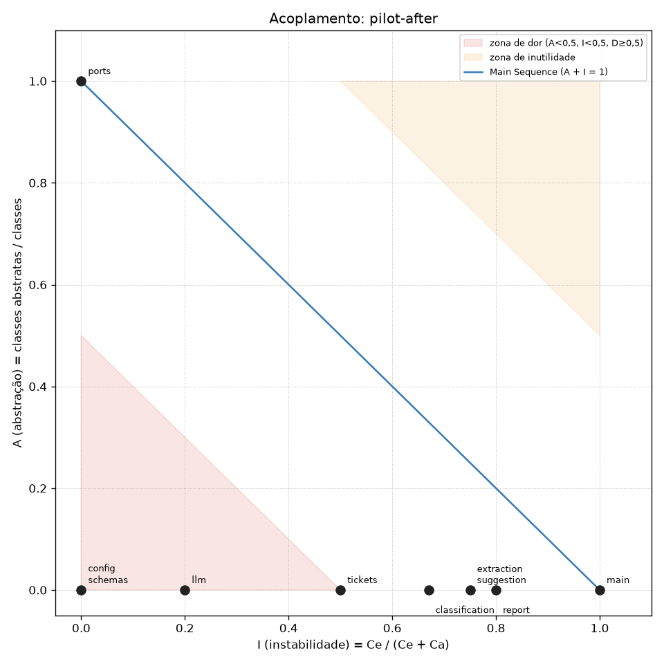

# Plano de refatoração: de `v1-coupled` a `v2-decoupled`

> Requisito 4. Refatoração é mudança de estrutura **sem** mudança de comportamento: o juiz do comportamento é a suíte de caracterização (`tests/characterization/`, idêntica entre as tags), e o juiz da estrutura é a métrica (`metrics/coupling.py`, régua do requisito 3, [ADR 0008](adr/0008-medir-acoplamento-pela-regua-fixa.md)).

## 1. Ponto de partida (medido)

`metrics/results/v1-coupled.csv`:

| component | ca | ce | i | a | d | leitura |
|---|---|---|---|---|---|---|
| classification | 1 | 3 | 0.75 | 0.00 | 0.25 | depende de `llm` e `config` concretos |
| config | 6 | 0 | 0.00 | 0.00 | **1.00** | **zona de dor**: modelos físicos, chaves e URLs dos providers; todo mundo importa |
| extraction | 1 | 3 | 0.75 | 0.00 | 0.25 | idem `classification` |
| llm | 4 | 1 | 0.20 | 0.00 | **0.80** | **zona de dor**: dois SDKs, sem timeout/retry; as 4 features chamam direto |
| main | 0 | 5 | 1.00 | 0.00 | 0.00 | rotas; não monta nada (as features buscam suas dependências sozinhas) |
| report | 1 | 4 | 0.80 | 0.00 | 0.20 | depende de `llm`, `config`, `tickets` |
| schemas | 5 | 0 | 0.00 | 0.00 | **1.00** | **zona de dor** pela fórmula; tipos de valor do contrato HTTP |
| suggestion | 1 | 3 | 0.75 | 0.00 | 0.25 | idem `classification` |
| tickets | 1 | 1 | 0.50 | 0.00 | 0.50 | leitura de `/data/tickets.jsonl`; caminho vem de `config` |

O diagnóstico da v1 (README) liga as dores a esses mesmos pontos: o nome do modelo e o provider em `config`, a chamada sem timeout/fallback em `llm`, e cada feature presa ao seu provider.

## 2. Componentes-alvo e estratégia (versão inicial)

| Alvo | Problema | Estratégia | Resultado esperado |
|---|---|---|---|
| `llm` | concreto (A 0) e muito usado (Ca 4): o detalhe mais volátil (provider, SDK, formato) é do que as features dependem | **Inverter a dependência**: uma porta `ports.LLMGateway` (`typing.Protocol`) que as features usam; a implementação concreta fica num único componente, montado pelo ponto de composição (`main`) | `ports` com A 1, I 0 (na Main Sequence); o componente concreto deixa de ser importado pelas features |
| features (`classification`, `suggestion`, `extraction`, `report`) | buscam `llm` e `config` sozinhas (import de módulo global) | **Compor em vez de buscar**: a feature recebe o gateway (injeção pelo ponto de composição) e pede uma **capacidade lógica**, sem saber provider nem modelo | Ce só para `ports` e `schemas` |
| `config` | Ca 6: nomes físicos e chaves espalhados | **Reduzir Ca**: nomes físicos saem do app (vão para o gateway na F05); o que sobra (endereço e chave do gateway, timeouts) é lido por quem monta a aplicação | Ca cai a cada feature migrada |
| `tickets` | caminho do arquivo vem de `config` | receber o caminho de quem monta (sem `config`) | Ce 0 |
| `schemas` | D 1 pela fórmula | **não mexer**: tipos do contrato, fixados pela suíte | candidato a "estável por natureza" (ADR 0008) |

## 3. Critério de pronto

1. `python -m pytest tests/characterization -q` passa e `git diff v1-coupled -- tests/characterization/` é vazio.
2. Nenhum componente na zona de dor (A < 0,5, I < 0,5 e D ≥ 0,5), exceto os declarados no ADR 0008 como estáveis por natureza (nunca o componente que chama o gateway nem as features).
3. O código que chama o modelo (SDK/HTTP) fica num único componente, e só o ponto de composição o importa (`grep` nas features vazio).
4. A partir da F05: nenhum nome físico (`gpt-fake-*`, `claude-fake-*`) nem chave de provider em `app/`.

## 4. Piloto: `classification`

**Por que este componente:** é a feature mais simples (saída curta, sem estado, sem I/O próprio), com um caso de erro de valor (502) que precisa continuar igual; o raio de impacto é uma rota.

**O que mudou** (commit do piloto na F04):

- `app/helpdesk/ports.py` (novo): `class LLMGateway(Protocol)` com `complete(capability, task, content) -> str`.
- `app/helpdesk/classification.py`: `classify(ticket, gateway: LLMGateway)` pede a capacidade lógica `"classification"`; deixou de importar `config` e `llm` (o `llm.parse_json`, que era só `json.loads`, virou `json.loads` local).
- `app/helpdesk/llm.py`: `ProviderGateway`, implementação **provisória** da porta sobre os SDKs, que mapeia `"classification"` para `call_openai(config.CLASSIFICATION_MODEL, ...)`, exatamente a chamada da v1.
- `app/helpdesk/main.py`: monta `gateway = llm.ProviderGateway()` e injeta na rota da F1.

**Comportamento:** `python -m pytest tests/characterization -q` → **17 passed**, com `tests/characterization/` idêntico ao da `v1-coupled` ([evidência](evidence/f04/pytest-pilot.txt)).

**Medição antes × depois** ([antes](evidence/f04/pilot-before.csv), [depois](evidence/f04/pilot-after.csv)):

| component | antes (ca, ce, i, a, d) | depois (ca, ce, i, a, d) | leitura |
|---|---|---|---|
| classification | 1, 3, 0.75, 0.00, 0.25 | 1, **2**, 0.67, 0.00, 0.33 | depende só de `ports` e `schemas` ✔ |
| ports | — | 1, 0, 0.00, **1.00**, **0.00** | abstração estável, na Main Sequence ✔ |
| llm | 4, 1, 0.20, 0.00, 0.80 | 4, 1, 0.20, 0.00, **0.80** | **não melhorou**: a feature saiu, mas `main` entrou como importador |
| config | 6, 0, 0.00, 0.00, 1.00 | **5**, 0, 0.00, 0.00, **1.00** | caiu 1 por feature migrada; continua com D 1 |
| main | 0, 5, 1.00, 0.00, 0.00 | 0, 6, 1.00, 0.00, 0.00 | ganhou a montagem (esperado: é o ponto de composição) |
| demais | iguais | iguais | — |

## 5. Revisões do plano

### Revisão 1 (após o piloto, 2026-10-13)

O piloto confirmou a inversão de dependência para a feature, mas mostrou três coisas que o plano inicial não previa:

1. **Migrar as features não tira `config` da zona de dor.** Cada feature migrada tira 1 de Ca (6 → 5), mas um módulo concreto sem dependências (Ce 0) que **alguém** importa tem I = 0 e D = 1, mesmo com Ca 1. Enquanto existir um `config` compartilhado, ele fica na zona, e com razão: é o lugar onde mora o que muda (endereços, chaves, nomes).
   **Mudança:** em vez de "reduzir Ca de `config`", **dissolver `config`**. Os nomes físicos e as chaves saem do app (vão para o gateway, F05). O que sobra (URL e chave do gateway, timeouts, caminho dos tickets, tamanho do lote) é lido do ambiente **no ponto de composição** (`main`) e passado a quem precisa por construtor/argumento.
2. **O componente concreto que fala com o modelo precisa depender da abstração que implementa.** O `ProviderGateway` provisório mora em `llm`, que segue com Ca 4 até a última feature migrar. Depois disso, `llm` (ou o seu sucessor) seria importado só por `main` (Ca 1). Mas, se ele não importar nada do app, cai em I = 0 e D = 1, como `config`.
   **Mudança:** o cliente do gateway vira `adapters/gateway.py`, com uma classe que **declara** a porta que implementa (`class GatewayClient(LLMGateway)`). É a forma do Princípio da Inversão de Dependência (o detalhe depende da abstração), e o type checker passa a verificar a assinatura; o efeito na métrica (Ce 1 → I 0,5) é consequência, não motivo. Não haverá import que exista só para a métrica.
3. **Helpers no módulo errado mantêm dependências que não são de comportamento.** `classification` importava `llm` também por `parse_json` (um `json.loads`). As outras features fazem o mesmo.
   **Mudança:** cada feature faz o próprio parse; o módulo concreto só fala com o modelo.

Também decidido a partir do piloto:

- `tickets` sofre do mesmo problema de folha concreta: vira implementação de uma segunda porta, `ports.TicketSource` (`in_period(start, end)`), recebida por `report`; o caminho do arquivo vem de `main`.
- A porta continua **mínima** na v2 (`complete(capability, task, content) -> str`): streaming e chamadas assíncronas só entram na F07, quando o contrato HTTP mudar. `max_tokens` (2000, usado pela v1 no formato Messages) fica no adaptador, não na porta.
- As capacidades lógicas são nomes do contrato entre app e infraestrutura: cada feature declara a sua (`CAPABILITY`), e o mapeamento para o modelo físico vive só no gateway (F05). Nome final das capacidades: `helpdesk-classify`, `helpdesk-suggest`, `helpdesk-topics`, `helpdesk-extract` (o `"classification"` do piloto é renomeado na F05).

### Alvos revisados para a `v2-decoupled`

| Componente (v2) | Papel | Depende de (Ce) | Importado por (Ca) | Esperado |
|---|---|---|---|---|
| `ports` | `LLMGateway`, `TicketSource` (Protocol) | — | features, adaptadores | A 1, I 0, D 0 |
| `adapters.gateway` | **único** cliente HTTP do gateway (SDK `openai`, `max_retries=0`, timeout explícito) | `ports` | `main` | I 0,5, fora da zona |
| `tickets` | `TicketSource` sobre `/data/tickets.jsonl` | `ports` | `main` | I 0,5, fora da zona |
| `classification`, `suggestion`, `extraction`, `report` | regras de cada feature | `ports`, `schemas` | `main` | I ≥ 0,67 |
| `main` | rotas + ponto de composição (lê o ambiente, monta e injeta) | todos | — | I 1 |
| `schemas` | tipos do contrato HTTP | — | `main`, features | D 1: **exceção estável por natureza** (ADR 0008) |
| `config`, `llm` | — | — | — | **removidos** |

## 6. Handoff para o agente de IA

### Protocolo (definido na F04, executado na F05)

**O que o agente recebe:**

1. Este plano (com a Revisão 1 e a tabela de alvos revisados).
2. A medição atual (`python metrics/coupling.py app/helpdesk --name wip --out-dir <tmp>`) e o critério de pronto da seção 3.
3. As regras inegociáveis: não alterar `tests/characterization/`, `provider-fake/`, `edge/`, `data/`; não mudar rotas, corpos, status nem modos de resposta; um modelo `large` por capacidade; nenhum nome físico nem chave de provider em `app/`; nada fora do escopo (cache, circuit breaker etc.).
4. Um alvo por vez, na ordem: `suggestion` → `extraction` → `report` + `tickets` → `adapters.gateway` (troca do `ProviderGateway` pelo cliente do gateway) → dissolver `config` e `llm`.

**Como a saída do agente é aceita ou rejeitada** (por alvo, antes do commit):

| Juiz | Comando | Aceita se |
|---|---|---|
| Comportamento | `docker compose up -d --build --wait app && python -m pytest tests/characterization -q` | 17 passed |
| Suíte intocada | `git diff --exit-code v1-coupled -- tests/characterization/` | vazio |
| Estrutura | `python metrics/coupling.py app/helpdesk --name wip --out-dir <tmp>` | nenhum componente novo/alterado na zona de dor (exceto `schemas`); nenhuma feature com Ce para concretos |
| Restrições | `grep -rE "gpt-fake\|claude-fake" app/`; `grep -rnE "adapters" app/helpdesk \| grep -v main.py` | vazios (o primeiro só ao final da F05) |

Qualquer falha devolve o alvo ao agente com a saída do juiz; o diff só é commitado depois dos quatro juízes verdes. As interações ficam registradas abaixo.

### Registro do handoff (F05, 2026-10-13)

**Antes do handoff (feito por mim, não pelo agente):** o gateway LiteLLM e o `gateway-db` subiram no compose com as quatro capacidades lógicas em modelos `large` e a chave virtual do app semeada na subida (commit `91c83f5`). Conferi direto no gateway, com `max_tokens: 2000` e a mesma mensagem da v1, que as quatro tarefas devolvem o mesmo texto da v1: a sugestão é idêntica ao golden (2.424 caracteres), e o relatório de um dia gera os mesmos temas com os mesmos 6.132 tokens de entrada. Isso tirou do caminho do agente o maior risco (a tradução Messages → Chat Completions mudar a saída).

**O que foi entregue ao agente:** um subagente Claude Code (Claude Opus 5.5), no mesmo clone e branch, com o compose no ar. Recebeu o [prompt literal](evidence/f05/handoff-prompt.md): este plano, os cinco alvos restantes em ordem, o desenho esperado de cada um (porta, nomes das capacidades, construtor do `GatewayClient`, variáveis do ponto de composição, versões fixadas no `requirements.txt`), as regras inegociáveis e os quatro juízes com os comandos exatos, mais a regra de só commitar um alvo depois dos quatro verdes.

**Iterações** ([log do agente](evidence/f05/handoff-log.md)):

| Alvo | Commit | Juízes | Observação |
|---|---|---|---|
| 1. `suggestion` | `7883f87` | 4/4 (17 passed) | o primeiro juiz 3 falhou por um problema no **script de juízes do agente** (o Python do Windows não resolvia o `/tmp` do Git Bash); corrigido com `cygpath`, sem mexer na métrica nem no código, e o mesmo CSV foi reavaliado |
| 2. `extraction` | `ff6941e` | 4/4 | — |
| 3. `report` + `tickets` | `a72685f` | 4/4 | `main` montou `JsonlTicketSource(config.TICKETS_FILE)` provisoriamente até o alvo 4 |
| 4. `adapters.gateway` | `fcd8b71` | 4/4 | **desvio aceito:** o bloco `environment` do serviço `app` entrou aqui, e não no alvo 5, porque o `GatewayClient` montado em `main` exige as variáveis, e sem elas o juiz 1 não subiria o app |
| 5. dissolver `config` e `llm` | `ec1a935` | 4/4 | `env_file` removido do `app`; `anthropic` removido; `pydantic`/`pydantic_core` fixados |

Nenhum alvo foi rejeitado pelos juízes. Outro desvio reportado e aceito: o SDK `openai` com `base_url=http://gateway:4000` chama `POST /chat/completions` (sem `/v1`), rota que o LiteLLM também atende (confirmado no log do gateway).

**Aceite independente** (refeito por mim depois do agente, a partir de `docker compose down -v`, [evidência](evidence/f05/judges.txt)): 17 passed; suíte idêntica à `v1-coupled`; nenhum nome físico, chave de provider nem referência ao `provider-fake` em `app/`; `env` do `app` só com `GATEWAY_BASE_URL` e `GATEWAY_API_KEY`; `docker compose config` sem `env_file` no `app`; único cliente do modelo em `adapters/gateway.py`, importado só por `main.py`; `/admin/calls` + log do gateway mostram cada chamada da borda passando pelo gateway.

Revisei também o código entregue: as features ficaram com a mesma lógica da v1 (mensagem `TASK: ...`, validações 502/422, lotes de 150 com a mesma agregação). A única mudança de estrutura fora do pedido foi o `MAX_OUTPUT_TOKENS = 2000` como constante do ponto de composição (aceito: é configuração do cliente, não regra de feature).

### Medição final: `v1-coupled` → `v2-decoupled`

| component | v1 (ca, ce, i, a, d) | v2 (ca, ce, i, a, d) |
|---|---|---|
| adapters.gateway | — | 1, 1, 0.50, 0.00, 0.50 |
| classification | 1, 3, 0.75, 0.00, 0.25 | 1, 2, 0.67, 0.00, 0.33 |
| config | 6, 0, 0.00, 0.00, **1.00** | *removido* |
| extraction | 1, 3, 0.75, 0.00, 0.25 | 1, 2, 0.67, 0.00, 0.33 |
| llm | 4, 1, 0.20, 0.00, **0.80** | *removido* |
| main | 0, 5, 1.00, 0.00, 0.00 | 0, 7, 1.00, 0.00, 0.00 |
| ports | — | 6, 0, 0.00, 1.00, 0.00 |
| report | 1, 4, 0.80, 0.00, 0.20 | 1, 2, 0.67, 0.00, 0.33 |
| schemas | 5, 0, 0.00, 0.00, **1.00** | 5, 0, 0.00, 0.00, **1.00** |
| suggestion | 1, 3, 0.75, 0.00, 0.25 | 1, 2, 0.67, 0.00, 0.33 |
| tickets | 1, 1, 0.50, 0.00, 0.50 | 1, 1, 0.50, 0.00, 0.50 |

Critério de pronto da seção 3: (1) suíte verde e idêntica ✔; (2) só `schemas` na zona de dor, exceção estável por natureza a declarar no ADR 0008 ✔; (3) cliente do modelo num único componente, importado só pelo ponto de composição ✔; (4) sem nomes físicos nem chaves em `app/` ✔.
